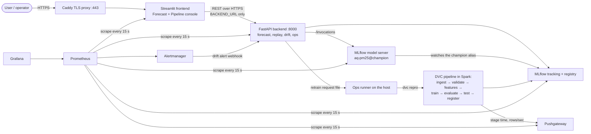

# Air Quality Forecasting with AIOps

This is my DA3408 course project. It forecasts PM2.5 for seven Indian cities (Delhi, Chennai, Lucknow, Hyderabad, Bengaluru, Jaipur, Kolkata), 1 hour and 24 hours ahead. It shows the result to ordinary users as a CPCB colour and one line of health advice.

The interesting part is what happens around the model. I replay the 2020 COVID lockdown hour by hour as if it were live traffic. The air suddenly gets much cleaner, the system notices that the data no longer looks like earlier years, retrains by itself, and swaps in the new model only if it beats the current one on the same hours. If a new model misbehaves, one button (or one command) rolls it back.

Everything runs on one 8 GB ARM64 VM with no cloud services: Spark for data, DVC for the pipeline and data versions, MLflow for tracking, the registry and serving, FastAPI and Streamlit for the app, and Prometheus, Alertmanager and Grafana for monitoring.

## Architecture



The frontend knows one thing about the rest of the system: `BACKEND_URL`. Everything it shows comes from the REST API in `docs/LLD.md`. The backend does the work: it builds the feature row for the simulated "now", asks the model server for both horizons in one call, turns PM2.5 into a category, computes drift, and handles the operator actions behind an API key. Training is too heavy for the backend container, so the backend only writes a request file. A small runner on the host picks it up and runs `dvc repro` there. That way no container needs access to the Docker socket. The same pipeline is packaged as the `batch` compose profile (`docker compose --profile batch run --rm pipeline dvc repro`). I built that image and checked its packages, but the runner does not use it, and I have not run a full pipeline inside it.

I split compose into two profiles because of the 8 GB limit. `serve` is always on (10 small containers, about 1.3 GiB at idle). `batch` holds Spark and training, and never runs next to the full serve stack.

The diagram with every block explained is in `docs/architecture.md`. The design choices and their reasons are in `docs/HLD.md`.

## Run it

You need Docker with Compose, [uv](https://docs.astral.sh/uv/), Java 17 (for Spark) and openssl. The DVC remote is a folder on this VM (`.dvc/config`). On another machine, copy that folder over and point DVC at it with `dvc remote modify localremote url <path>`.

**Once, on a fresh clone:**

```
scripts/bootstrap.sh
```

It writes `.env` with a random operator key, makes the certificates, installs the pinned Python environment (`uv sync --frozen`), pulls the raw data with `dvc pull`, and runs the whole pipeline once, which registers the first model as champion. In a fresh clone on this VM it took 7 min 20 s: 6 minutes to download the Python packages that were not in uv's cache, and 75 s for the pipeline itself. git and DVC hold the code and the data, but not the MLflow registry. Without this first run the model server has no model to load, and the backend never starts. The script refuses to run while the serve stack is up, because Spark and the stack do not fit in 8 GB together.

**Every time, two commands:**

```
docker compose --profile serve up -d
uv run --frozen python -m src.ops.runner
```

The first starts the app and the monitoring (10 containers). The second starts the ops runner on the host and keeps running, so start it in its own terminal or with `nohup`. The runner turns retrain requests into `dvc repro`. Without it, a drift alert still fires and a retrain request is still written to `ops/requests/`, but it stays `queued` and nothing retrains. During a retrain the runner stops the frontend and Grafana for two to three minutes, so the batch never runs next to the full stack, and starts them again afterwards. In that time the page shows "Back in a few minutes".

Open **https://localhost**. The browser warns about the certificate the first time, because I made it myself. `docs/user_manual.md` explains what that means and how to get rid of it. The console is at `https://localhost/console`, Grafana at `http://localhost:13000`, MLflow at `http://localhost:5000` and Prometheus at `http://localhost:19090`.

Other commands I use:

```
scripts/ci.sh                         # lint, 353 tests, dvc status, dvc status -c (about 1 min)
docker compose --profile serve stop
scripts/ci.sh --repro                 # + the full DVC pipeline and dvc push (about 2.5 min)
python -m scripts.replay              # drift acceptance test over 2016-2020
python -m scripts.rollback --list     # registry versions and aliases
docker compose --profile serve up -d --build   # after changing service code; plain up -d keeps the old images
mlflow run . -e main --env-manager uv --experiment-name aq-pm25   # train through MLproject in its own environment
```

## What I measured

All of these were measured on the project VM (4 CPU, 7.2 GB RAM, ARM64). The full tables, with how each number was taken, are in `docs/metrics.md`.

**Pipeline (Spark, local mode, 2 GB driver).** It ingests 3,434,754 rows from 5 CSV files. Ingest takes 8 to 10 s (about 330,000 to 430,000 rows/s, CSV 283 MB to Parquet 65 MB), validate 32 to 37 s (48 checks), features 12 to 15 s and train 24 to 27 s. The whole 7-stage `dvc repro` took 97 s in the last CI run. pandas did the ingest job twice as fast as Spark (3.7 s against 8.2 s), because the data fits in memory and Spark pays for JVM start-up and job planning. I use Spark because the course requires it, and because its code keeps working when data outgrows RAM. I have not tested that second point.

**Model.** Mean absolute error in µg/m³, every model scored on the same rows:

| Model | v1, 1 h | v1, 24 h | v4 (lockdown), 1 h | v4 (lockdown), 24 h |
|-------|-----:|-----:|-----:|-----:|
| Persistence | 5.13 | 14.70 | 4.02 | 10.80 |
| Seasonal naive | 15.49 | 14.70 | 10.26 | 10.80 |
| Ridge | 5.03 | 14.25 | 4.27 | 10.55 |
| **LightGBM (served)** | **4.50** | **13.54** | **3.54** | **9.39** |

v1 was trained up to 24 March 2020. v4 is the model the system trained by itself after the drift alert, with data up to 2 April. The evaluation windows are short (497 rows at 1 h, 336 at 24 h). Per city the model is not better everywhere. On v4's window it beats the best baseline in all 7 cities at 1 h, but at 24 h it loses to it in 4 of 7 (Chennai, Lucknow, Hyderabad and Jaipur, by 0.5 to 2.1 µg/m³). It still has the lowest MAE over all cities together at 24 h, mainly because of Delhi (11.06 against 14.38). Each city has only about 48 rows at 24 h on this window, so these per-city numbers are noisy. On v1's window it lost in Kolkata and Lucknow.

**Serving.** `GET /forecast` over HTTPS takes 9.5 ms at p50 and 13.5 ms at p95 (300 serial calls). The acceptance limit was 300 ms. The model server alone takes 6.5 ms for the 14 rows the backend sends. A cold start of the stack takes 25 to 36 s with 0 restarts.

**Drift and retraining.** Replaying 25 March to 30 June of every year, the drift rule fires for 661 of 2,185 hours in 2020 and for 0 hours in 2016-2019. In the live loop it took 2 min 47 s from "drift is true" to the new model answering forecasts: the alert, the webhook, the retrain request, `dvc repro` with the new cutoff, the gate, the registry and the hot swap. The new model beat the old one on the lockdown window (mean MAE 6.467 against 6.750).

**Tests.** 353 pytest cases, 353 passed, 0 failed. `docs/test_report.md` checks the seven acceptance criteria one by one, and all seven are met.

## Reproduce a result

Every model can be traced to the code and data that made it. Each MLflow run is tagged with `git_commit`, `git_dirty`, `cutoff`, `dvc_data_md5` (the raw data version) and `features_md5` (a hash of the feature values). To rebuild a model from its run ID:

```
# 1. read the tags of the run (or open it in the MLflow UI)
python -c "import mlflow; print(mlflow.MlflowClient('sqlite:///mlflow.db').get_run('<run_id>').data.tags)"
# 2. get that code and data
git checkout <git_commit>
dvc pull
# 3. if git_dirty is true because the ops runner moved the cutoff, set the run's
#    cutoff in params.yaml (that is the only file the runner changes)
# 4. rebuild (batch profile only, so stop the serve stack first)
docker compose --profile serve stop
dvc repro
```

I checked this on the current champion. Its run `498b149f…` gives commit `b2eff79` and cutoff 2020-04-02 19:00. A clean rebuild with that cutoff gave the same data and feature hashes, the same MAE to every printed digit (6.467113514419853), and LightGBM model files that are identical byte for byte. The rebuild was at commit `92537ef`, a later commit with the same pipeline code; I did not check out `b2eff79` itself (`docs/test_report.md`, AC-6). Training is deterministic because I made it so (see below).

## What broke, and how I fixed it

These are the problems that taught me the most. The full story of each stage is in `docs/PROGRESS.md`.

**DVC said "up to date" while the remote was empty.** A broad `/data/*` rule in `.gitignore` made DVC skip `data/raw.dvc` without any error. I replaced it with the exact sub-folders. Since then I check `dvc status -c` in CI rather than trusting `dvc push`.

**LightGBM was not repeatable.** The same stage gave 14.20 and then 14.13 at 24 h with nothing changed, and single predictions differed by up to 5 µg/m³. With `deterministic` and `force_row_wise` the fits are identical, and a test checks it. Without that, "reproducible from commit + run ID" would have been a false claim.

**My data fingerprint changed on every run.** Spark puts random IDs in part-file names, and even after removing the names, 63 bytes of the Parquet footer differed between identical runs. I now hash the values themselves, sorted by city and time. A tag that is always different looks exactly like a tag that works, so I would not have noticed without comparing two runs.

**The drift rule I designed could never fire.** The plan was "3 cities above their PSI threshold and the 72 h error ratio above 1.5". I measured it before building anything around it. It fired for 13 hours in normal 2018 and never during the lockdown. The model's error grows with the PM2.5 level, and lockdown air is cleaner, so the error went *down* (ratio at most 1.47). I took the error condition out of the trigger and set the city count from normal weeks only: in 2016-2019 at most 3 cities were ever above threshold at once, so the rule needs 4. The margin is one city, and I say so in the test report.

**MLflow kept getting killed.** At a 512 MB limit it was OOM-killed 11 times in 5 minutes, and at 1 GB it still hit the limit. The cause was 4 server workers plus a background job runner. With one worker and the job runner off, it uses about 350 MB.

**Services started before their dependencies were ready.** Plain `depends_on` only waits for a container to start. I added health checks and `condition: service_healthy`, so mlflow, model server, backend and frontend come up in order and a cold start needs no manual restart.

**The proxy made every page 40 times slower.** Through Caddy, Streamlit's health check took 42 ms instead of 0.3 ms, but only on reused connections. That pointed to a Nagle and delayed-ACK stall. Turning off keep-alive from Caddy to Streamlit brought it to 1.0 ms.

**Rollback through the app had never worked.** I found this while writing the test report. The first `POST /ops/rollback` hung, and MLflow logged "attempt to write a readonly database". I had mounted `mlflow.db` as a single file, so its folder inside the container belonged to root and SQLite could not write its journal. Reads worked, and as far as I can tell every earlier write had come from a process on the host, which is why nothing showed it. Worse, the backend kept retrying the call I had given up on, and applied that rollback about 4 minutes later. I now mount the folder, and the backend's MLflow client gives up after 2 retries and 10 s.

## Where to find things

| What | Where |
|------|-------|
| Architecture, HLD, LLD (API contract) | `docs/architecture.md`, `docs/HLD.md`, `docs/LLD.md` |
| Test plan, test report | `docs/test_plan.md`, `docs/test_report.md` |
| User manual | `docs/user_manual.md` |
| Measured numbers | `docs/metrics.md` |
| EDA and data biases | `docs/eda.md` |
| Rubric checklist | `docs/rubric_checklist.md` |
| Pipeline code (Spark stages, training, gate, registry) | `src/pipeline/`, `dvc.yaml`, `params.yaml`, `MLproject` |
| Backend, frontend, model server | `src/backend/`, `src/frontend/`, `src/model_server/` |
| Drift, ops runner | `src/monitoring/drift.py`, `src/ops/runner.py`, `scripts/replay.py` |
| Monitoring | `monitoring/` (Prometheus, alert rules and promtool tests, Grafana dashboards) |
| Containers | `docker/`, `docker-compose.yml`, `scripts/build_multiarch.sh` |
| CI | `scripts/ci.sh`, `.pre-commit-config.yaml`, `reports/ci/` |

## Not done yet

- The multi-arch images (amd64 and arm64) are not on Docker Hub. `scripts/build_multiarch.sh` is written, but it needs my Docker Hub login and QEMU emulation, which needs sudo on this VM.
- The screenshots in the user manual and of Grafana and a fired alert still need to be taken in a desktop browser.
