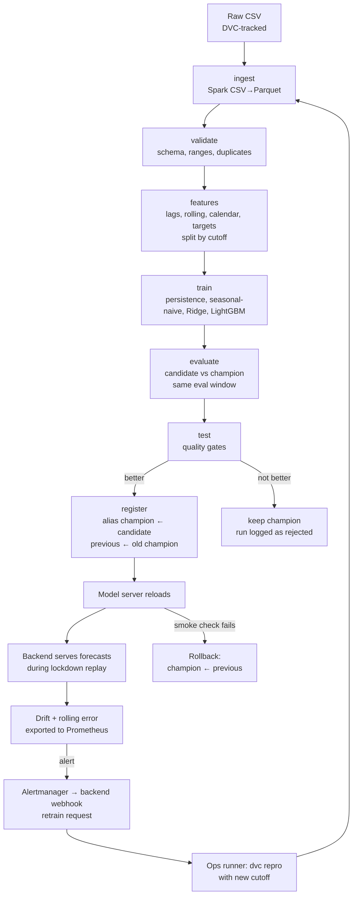

# High-Level Design

## 1. Problem and scope

Forecast hourly PM2.5 for 7 Indian cities (Delhi, Chennai, Lucknow, Hyderabad, Bengaluru, Jaipur, Kolkata)
1 hour and 24 hours ahead. Show the result as a CPCB AQI category with health advice. Treat the
COVID lockdown (25 Mar - 30 Jun 2020) as live traffic that is replayed in time order. Detect the resulting drift,
retrain automatically, promote only better models, and support rollback.

The cities were chosen because they have long history and < 15% missing PM2.5 (see `docs/data_notes.md`).

## 2. Lifecycle (HLD diagram)

## 3. Design choices and rationale

| Decision | Choice | Rationale |
|----------|--------|-----------|
| Paradigm | **Functional** pipeline stages: each transform is a function `f(DataFrame, params) -> DataFrame`, and I/O happens only at the stage entry point. **Object-oriented** services: `Forecaster`, `ReplayClock`, `DriftMonitor`, `RegistryClient`, `BackendClient`. | Pure transforms are easy to unit-test and reason about. Services hold state (clock, model version, drift windows), so objects fit them. |
| Main data table | `city_hour.csv` | Matches the "city, 1h/24h" problem. The station files are ingested and validated, but not modelled (3.6x larger, little extra value). |
| Data engine | Spark local mode, driver 3g, 8 shuffle partitions, Parquet after ingest | Required engine. Parquet is columnar and compressed, so later stages read only the columns they need. |
| Models | Persistence, seasonal-naive (t-24h), Ridge, LightGBM; one LightGBM per horizon | Baselines show the main model adds value. LightGBM handles NaNs and non-linearity, and is fast on CPU. |
| Packaging the model | One pyfunc `aq-pm25` that holds both horizon models; the input carries `horizon_h` | One model server process instead of two (saves RAM). One version number for both horizons. |
| Time split | `cutoff` param (initially 2020-03-24 23:00). Training data is everything before `cutoff − eval_window_days`; the evaluation window is the last `eval_window_days` (3) before the cutoff. Recency weights use a 30-day half-life. | The same rule works for the first training and for retraining after drift. A short evaluation window means models are compared on the most recent regime. |
| Promotion rule | Promote only if the candidate's mean MAE (1h and 24h) on the evaluation window is lower than the champion's on the **same** window, **and** LightGBM ≤ 1.02 × best baseline per horizon | It compares like with like and blocks models that are worse than trivial baselines. |
| Registry and rollback | MLflow aliases `champion` and `previous`. Rollback moves `champion` to `previous` (or to a given version). | Rollback is a metadata change, so it is instant, auditable and reversible. |
| Model reload | A watcher in the model-server container polls the `champion` alias every 30s and restarts `mlflow models serve` when it changes | The backend never needs Docker access, and promotion takes effect without manual steps. |
| Live traffic | The backend's `ReplayClock` advances simulated time from 2020-03-25 at `REPLAY_SPEED_HPS` (default 1 simulated hour per second). Forecasts use features at the simulated "now"; actual values are revealed only when the clock passes them. | It gives realistic, time-ordered traffic and lets the demo show drift within minutes. |
| Drift detection | PSI of `pm25_lag_1` per city: the last 168 replayed hours vs the training baseline (baseline saved as a model artifact). Rolling 72h MAE ratio vs evaluation-window MAE. Thresholds: PSI > 0.2, ratio > 1.5. | PSI catches input shift before labels arrive. The MAE ratio confirms the model actually got worse. |
| Retraining trigger | Prometheus alert → Alertmanager → `POST /ops/alerts` → retrain request file → host ops runner. A 30-minute cooldown applies. | Monitoring drives retraining with no human step, and the cooldown prevents retrain storms. |
| Memory | Compose `mem_limit` on every container. While batch runs, the runner pauses the frontend and Grafana. | Batch and the full serve stack never run together. Core serving and monitoring stay up. |
| Security | Bearer API key on `/ops/*` (constant-time compare); HTTPS on the backend (self-signed certificate); secrets only in `.env`; non-root containers; no Docker socket in containers | Ops actions change production state, so they need authentication. TLS encrypts traffic in transit. |
| Reproducibility | Every MLflow run is tagged with `git_commit`, `dvc_data_md5` and `cutoff`. Every forecast response returns `model_version`, `mlflow_run_id` and `git_commit`. | Any prediction can be traced back to its exact code, data and run. |
| Loose coupling | The frontend uses only `BACKEND_URL` plus the REST contract in `docs/LLD.md`. The backend uses only `MODEL_SERVER_URL` and `MLFLOW_TRACKING_URI`. | Each service can be rebuilt, moved or replaced independently. |

## 4. AQI mapping

The CPCB PM2.5 breakpoints (µg/m³) are applied to the forecast value. The official AQI uses 24h averages, so the UI
labels the category as *indicative*.

| Category | PM2.5 | Colour | Health advice (CPCB) |
|----------|-------|--------|----------------------|
| Good | 0-30 | #00B050 | Minimal impact. |
| Satisfactory | 31-60 | #92D050 | Minor breathing discomfort to sensitive people. |
| Moderate | 61-90 | #FFFF00 | Breathing discomfort to people with lung disease such as asthma, and discomfort to people with heart disease, children and older adults. |
| Poor | 91-120 | #FF9900 | Breathing discomfort to most people on prolonged exposure. |
| Very Poor | 121-250 | #FF0000 | Respiratory illness on prolonged exposure. |
| Severe | > 250 | #C00000 | Affects healthy people and seriously impacts those with existing diseases. |

## 5. Deployment

| Profile | Services | mem_limit (planned) |
|---------|----------|---------------------|
| serve | frontend 384m, backend 512m, model-server 768m, mlflow 512m, prometheus 384m, pushgateway 64m, alertmanager 64m, grafana 256m, node-exporter 64m | ≈ 3.0 GB |
| batch | pipeline 3.5g (Spark driver 3g) | 3.5 GB |
| during retrain | batch + serve without frontend and grafana | ≈ 6.1 GB |

These limits are planned figures. Actual usage is measured in Stage 13 and recorded in `docs/metrics.md`.

## 6. Failure handling

| Failure | Behaviour |
|---------|-----------|
| Validation errors (schema, impossible values) | The `validate` stage fails, the run is recorded as `failed` with the reason, and the champion is unchanged. |
| Candidate worse than champion or baselines | The `test` stage marks it rejected, nothing is registered as champion, and the run is visible in the console. |
| New champion fails the smoke check | The ops runner calls the rollback, and an alert and log entry are written. |
| Model server down | The backend returns 503 with a clear message, and the UI shows a friendly "forecast temporarily unavailable" notice. |
| Backend down | The UI shows a friendly error, and the Prometheus `up == 0` alert fires. |
