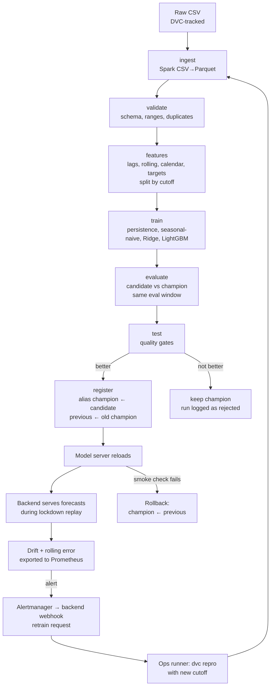

# High-Level Design

## 1. Problem and scope

I forecast hourly PM2.5 for 7 Indian cities (Delhi, Chennai, Lucknow, Hyderabad, Bengaluru, Jaipur, Kolkata), 1 hour and 24 hours ahead. The result is shown as a CPCB AQI category with health advice. I treat the COVID lockdown (25 Mar - 30 Jun 2020) as live traffic and replay it in time order. The system has to detect the resulting drift, retrain by itself, promote a new model only if it is better, and support rollback.

I picked these cities because they have a long history and less than 15% missing PM2.5 (see `docs/data_notes.md`).

## 2. Lifecycle (HLD diagram)

## 3. Design decisions

**Programming paradigm.** The pipeline stages are functional. Each transform is a function `f(DataFrame, params) -> DataFrame`, and I/O happens only at the stage entry point. The services are object-oriented: `Forecaster`, `ReplayClock`, `DriftMonitor`, `RegistryClient` and `BackendClient`. Pure transforms are easy to unit-test. The services hold state (the clock, the model version, the drift windows), so objects fit them better.

**Main data table.** I use `city_hour.csv`. It matches the "city, 1h/24h" problem directly. The station files are ingested and validated but not modelled. They are 3.6x larger and add little for a city-level forecast.

**Data engine.** Spark in local mode, with a 2g driver and 8 shuffle partitions, and Parquet after ingest. The course requires Spark. Parquet is columnar and compressed, so later stages read only the columns they need. On this small data pandas turned out about twice as fast as Spark at the ingest job (see `docs/metrics.md`). I keep Spark for the requirement and for data that would not fit in memory, but I have not measured the second reason.

**Models.** Persistence, seasonal-naive (t-24h), Ridge and LightGBM, and one served model per horizon: the better of Ridge and LightGBM. The baselines show whether the main model adds anything. I chose LightGBM because it handles NaNs and non-linear effects and is fast on CPU. It uses the median (L1) loss, because models are compared by MAE. I first used the default squared loss. On a 28-day test window the L1 version was better or equal in every comparison I ran, by about 0.7 µg/m³ at 24 h, at the price of roughly three times the training time (about 11 s per horizon). Training is deterministic (`deterministic` and `force_row_wise`). Without these two settings, two runs with the same seed and data gave predictions that differed by up to about 5 µg/m³, so a run could not be reproduced from its commit and data version.

**Missing values.** PM10 is null in about 40% of training rows, and the other inputs are 2-6% null. I keep every input column, because the input list is fixed in `docs/LLD.md`. LightGBM takes the nulls as they are. Ridge cannot, so its sklearn pipeline starts with a median imputer that also adds a missing-indicator flag for every column that has gaps, then scales the numbers and one-hot encodes city, hour, weekday and month. The imputer is fitted on the training rows only and is part of the pipeline object. The model therefore treats missing values the same way at training and at prediction time, and a missing PM10 can still carry information through its flag. Ridge is also a candidate for serving: if it beats LightGBM at a horizon, the package holds the Ridge pipeline for that horizon.

**Packaging the model.** One pyfunc called `aq-pm25` holds both horizon models, and the input carries `horizon_h`. That means one model-server process instead of two, which saves RAM, and one version number for both horizons.

**Time split.** A `cutoff` parameter (initially 2020-03-24 23:00) drives everything. Training data is everything before `cutoff − eval_window_days`, and a row only trains if its target hour is also before that point. Without this, the 24 h target of a late training row would fall inside the evaluation window. The evaluation window is the last `eval_window_days` (3) before the cutoff. Recency weights use a 90-day half-life. The same rule works for the first training and for retraining after drift. The short evaluation window compares models on the most recent regime, at the cost of a noisy estimate from only 3 days. In the first training run the window has 497 rows at 1 h and 336 rows at 24 h. I started with a 30-day half-life, and then the 24 h LightGBM sat 2.2% above the best baseline (Ridge). On a 28-day test window 30 days was the weakest setting at 24 h, so I changed it to 90 days. With 90 days LightGBM is the best model at both horizons: 4.50 at 1 h against 5.03 for Ridge, and 13.54 at 24 h against 14.25 for Ridge and 14.70 for persistence. I still do not trust small gaps on windows this short, in either direction. The same window is used for the comparison with the champion, where the short window matters most, and I report results with their row counts.

**Promotion rule.** For each horizon I register the best model, which is whichever of Ridge and LightGBM has the lower MAE on the evaluation window. That model must be within 1.02 times the best baseline for the horizon (persistence, seasonal naive or Ridge). I do not relax this limit. A new candidate is promoted only if its mean MAE over the two horizons is lower than the champion's on the same window. Comparing on the same window keeps the test fair, and the baseline condition blocks a model that is worse than a trivial one.

I decided on the per-horizon rule while the 24 h LightGBM was behind Ridge (30-day half-life), where it would have registered Ridge at 24 h. With the 90-day half-life LightGBM wins both horizons, so one model type is served and the question does not come up. The rule stays, because a retrain on lockdown data can change which model wins. The packaged model (`src/pipeline/aq_model.py`) can hold either model for each horizon. The train stage saves a LightGBM booster as `h<N>.txt` or a Ridge pipeline as `h<N>.joblib`, and `meta.json` lists which one each horizon holds (`kinds`). I used joblib for the Ridge pipeline because it ships with scikit-learn, so it adds no package. A joblib file is a pickle, so the package must only be loaded from my own registry. The Ridge path is covered by unit tests only, because on the real data LightGBM wins both horizons. "Best model" means the better of Ridge and LightGBM, as you confirmed. The rule-based baselines are the yardstick and are never served.

The `evaluate` stage loads the candidate and the champion as MLflow packages, the same way the model server will, and scores both on the same rows. The `test` stage applies the rule, and `register` creates the registry version and moves the aliases. A rejection is a normal result: the stages succeed, `reports/gate.json` says `passed: false` with the reasons, nothing is registered, and the training run is tagged `promotion=rejected`. The first model has no champion to beat, so only the baseline limit applies, and I did not relax it. A candidate that ties the champion is rejected, because a tie is not an improvement.

**Registry and rollback.** MLflow aliases `champion` and `previous` do the work. Rollback moves `champion` back to `previous`, or to a version I name. It is a metadata change, so it is instant, auditable and reversible.

**Model reload.** A watcher in the model-server container polls the `champion` alias every 30 seconds and restarts `mlflow models serve` when it changes. The backend never needs Docker access, and a promotion takes effect without manual steps.

**Live traffic.** The backend's `ReplayClock` advances simulated time from 2020-03-25 at `REPLAY_SPEED_HPS` (default: 1 simulated hour per second). Forecasts use the features at the simulated "now". Actual values are revealed only when the clock passes them. This gives realistic, time-ordered traffic and lets a demo show drift within minutes.

**Drift detection.** I use two signals. The first is the PSI of `pm25_lag_1` per city: the last 168 replayed hours against a same-season reference. The second is the rolling 72h MAE ratio against the evaluation-window MAE. PSI catches an input shift before labels arrive, and the MAE ratio confirms that the model really got worse. Drift is declared only when both agree: at least 3 cities have a PSI above their own threshold, and the pooled MAE ratio is above 1.5.

My first plan was to compare the live window with all the training data. That would be wrong, because PM2.5 follows the season strongly (in the EDA, Delhi is 5.5x higher in November than in August), and the replay runs from spring into summer. Normal seasonal change would look like drift. So the reference is the same hours of the calendar in earlier years, 2016 to 2019. The features stage cuts the replay window into 14 blocks of 168 hours and computes decile bins of `pm25_lag_1` for each city and block from those years. A live window whose last hour is replay hour h is compared with block `h // 168`. The result is saved in `reports/baseline_stats.json` and logged with every model as `drift_baseline.json`. Years are aligned on the replay start's month and day, so leap years do not shift the blocks. The limits are that Kolkata has only two reference years (2018-2019) and Jaipur three (2017-2019), that the station network grew over the years, and that a reference year can contain unusual events.

I measured how well a fixed PSI threshold works, and it does not. One week is only 168 hours of values that follow each other closely, and ten bins are a lot for that. In the weeks of the earlier years themselves, compared with the other years, the PSI has a median between 0.64 and 1.08 and a 90th percentile between 1.8 and 4.1. A threshold of 0.2 would fire almost every week. Lockdown weeks are higher in most cities (median 1.3 to 5.4), but they overlap with normal weeks, and in Hyderabad no lockdown week stands out (numbers in `docs/metrics.md`). So the decision rule is built from what normal weeks actually look like:

- **Per-city threshold.** For each city I compare every week (blocks 1 to 13) of every reference year with the same block of the other years, and take the 95th percentile of those PSI values as that city's threshold. The thresholds are saved in `reports/drift_thresholds.json`, next to the reference. Kolkata has only two reference years, so this cannot be done for it, and it does not vote.
- **Several cities together.** At least 3 cities must exceed their own threshold in the same window, so the weather of one city cannot trigger a retrain.
- **The MAE ratio as a second condition.** The pooled 72h MAE of the 1 h forecasts, divided by the model's 1 h MAE on its evaluation window, must be above 1.5. PSI says the inputs changed. The MAE says that it hurts.

The backend evaluates this rule and exports one gauge, `aq_drift_detected`. The Prometheus alert that starts a retrain watches that gauge, so the rule lives in one place. The values 95, 3 and 1.5 are settings (`DRIFT_MIN_CITIES` and `DRIFT_MAE_RATIO` for the last two).

The requirement is that the lockdown replay triggers this at least once, and that normal weeks do not trigger it. I have not built or tested this yet. It is a Stage 11 check: replay the same weeks of the earlier years and count false alarms, then replay the lockdown and confirm that it fires. If the rule cannot do both with these settings, I will report that and propose a change. I will not loosen the settings quietly until the demo works. The weak spot I can already see is Hyderabad, where the lockdown does not stand out from normal weeks.

**Retraining trigger.** A Prometheus alert goes to Alertmanager, which calls `POST /ops/alerts`, which writes a retrain request file that the host ops runner picks up. A 30-minute cooldown prevents retrain storms. No human step is needed.

**Memory.** Every container gets a compose `mem_limit`. While batch runs, the runner pauses the frontend and Grafana. Batch and the full serve stack never run together, and core serving and monitoring stay up.

**Security.** The `/ops/*` endpoints need a bearer API key, compared in constant time. The backend serves HTTPS with a self-signed certificate. Secrets live only in `.env`, containers run as non-root, and no container gets the Docker socket. Ops actions change production state, so they need authentication, and TLS encrypts the traffic.

**Reproducibility.** Every MLflow run is tagged with `git_commit`, `dvc_data_md5` and `cutoff`. Every forecast response returns `model_version`, `mlflow_run_id` and `git_commit`. Any prediction can be traced back to its exact code, data and run.

**Loose coupling.** The frontend uses only `BACKEND_URL` and the REST contract in `docs/LLD.md`. The backend uses only `MODEL_SERVER_URL` and `MLFLOW_TRACKING_URI`. Each service can be rebuilt, moved or replaced on its own.

## 4. AQI mapping

I apply the CPCB PM2.5 breakpoints (µg/m³) to the forecast value. The official AQI uses 24h averages, so the UI labels the category as *indicative*.

| Category | PM2.5 | Colour | Health advice (CPCB) |
|----------|-------|--------|----------------------|
| Good | 0-30 | #00B050 | Minimal impact. |
| Satisfactory | 31-60 | #92D050 | Minor breathing discomfort to sensitive people. |
| Moderate | 61-90 | #FFFF00 | Breathing discomfort to people with lung disease such as asthma, and discomfort to people with heart disease, children and older adults. |
| Poor | 91-120 | #FF9900 | Breathing discomfort to most people on prolonged exposure. |
| Very Poor | 121-250 | #FF0000 | Respiratory illness on prolonged exposure. |
| Severe | > 250 | #C00000 | Affects healthy people and seriously impacts those with existing diseases. |

## 5. Deployment

These are planned memory limits. I will measure real usage in Stage 13 and record it in `docs/metrics.md`.

| Profile | Services | mem_limit (planned) |
|---------|----------|---------------------|
| serve | frontend 384m, backend 512m, model-server 768m, mlflow 512m, prometheus 384m, pushgateway 64m, alertmanager 64m, grafana 256m, node-exporter 64m | ≈ 3.0 GB |
| batch | pipeline 2.5g (Spark driver 2g) | 2.5 GB |
| during retrain | batch + serve without frontend and grafana | ≈ 4.9 GB |

## 6. Failure handling

If validation fails (a wrong schema or an impossible value), the `validate` stage fails and the run is recorded as `failed` with the reason. The champion stays unchanged.

If a candidate is worse than the champion or the baselines, the `test` stage marks it rejected. Nothing is registered as champion, and the run is visible in the console.

If a new champion fails the smoke check, the ops runner calls the rollback and writes an alert and a log entry.

If the model server is down, the backend returns 503 with a clear message and the UI shows a friendly "forecast temporarily unavailable" notice.

If the backend is down, the UI shows a friendly error and the Prometheus `up == 0` alert fires.
