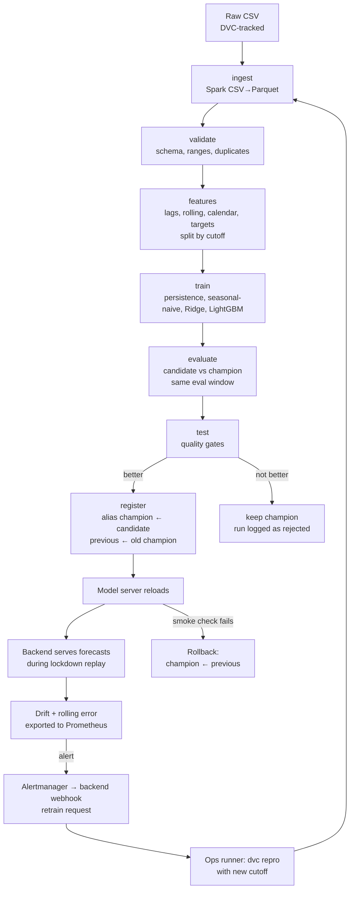

# High-Level Design

## 1. Problem and scope

I forecast hourly PM2.5 for 7 Indian cities (Delhi, Chennai, Lucknow, Hyderabad, Bengaluru, Jaipur, Kolkata), 1 hour and 24 hours ahead. The result is shown as a CPCB AQI category with health advice. I treat the COVID lockdown (25 Mar - 30 Jun 2020) as live traffic and replay it in time order. The system has to detect the resulting drift, retrain by itself, promote a new model only if it is better, and support rollback.

I picked these cities because they have a long history and less than 15% missing PM2.5 (see `docs/data_notes.md`).

## 2. Lifecycle (HLD diagram)

## 3. Design decisions

**Programming paradigm.** The pipeline stages are functional. Each transform is a function `f(DataFrame, params) -> DataFrame`, and I/O happens only at the stage entry point. The services are object-oriented: `Forecaster`, `ReplayClock`, `DriftMonitor`, `RegistryClient` and `BackendClient`. Pure transforms are easy to unit-test. The services hold state (the clock, the model version, the drift windows), so objects fit them better.

**Main data table.** I use `city_hour.csv`. It matches the "city, 1h/24h" problem directly. The station files are ingested and validated but not modelled. They are 3.6x larger and add little for a city-level forecast.

**Data engine.** Spark in local mode, with a 2g driver and 8 shuffle partitions, and Parquet after ingest. The course requires Spark. Parquet is columnar and compressed, so later stages read only the columns they need. On this small data pandas turned out about twice as fast as Spark at the ingest job (see `docs/metrics.md`). I keep Spark for the requirement and for data that would not fit in memory, but I have not measured the second reason.

**Models.** Persistence, seasonal-naive (t-24h), Ridge and LightGBM, with one LightGBM per horizon. The baselines show whether the main model adds anything. I chose LightGBM because it handles NaNs and non-linear effects and is fast on CPU.

**Packaging the model.** One pyfunc called `aq-pm25` holds both horizon models, and the input carries `horizon_h`. That means one model-server process instead of two, which saves RAM, and one version number for both horizons.

**Time split.** A `cutoff` parameter (initially 2020-03-24 23:00) drives everything. Training data is everything before `cutoff − eval_window_days`. The evaluation window is the last `eval_window_days` (3) before the cutoff. Recency weights use a 30-day half-life. The same rule works for the first training and for retraining after drift. The short evaluation window compares models on the most recent regime, at the cost of a noisy estimate from only 3 days.

**Promotion rule.** A candidate is promoted only if its mean MAE (1h and 24h) on the evaluation window is lower than the champion's on the same window, and LightGBM is within 1.02 × the best baseline for each horizon. Comparing on the same window keeps the test fair, and the baseline condition blocks a model that is worse than a trivial one.

**Registry and rollback.** MLflow aliases `champion` and `previous` do the work. Rollback moves `champion` back to `previous`, or to a version I name. It is a metadata change, so it is instant, auditable and reversible.

**Model reload.** A watcher in the model-server container polls the `champion` alias every 30 seconds and restarts `mlflow models serve` when it changes. The backend never needs Docker access, and a promotion takes effect without manual steps.

**Live traffic.** The backend's `ReplayClock` advances simulated time from 2020-03-25 at `REPLAY_SPEED_HPS` (default: 1 simulated hour per second). Forecasts use the features at the simulated "now". Actual values are revealed only when the clock passes them. This gives realistic, time-ordered traffic and lets a demo show drift within minutes.

**Drift detection.** I use two signals. The first is the PSI of `pm25_lag_1` per city: the last 168 replayed hours against the training baseline, which is saved as a model artifact. The second is the rolling 72h MAE ratio against the evaluation-window MAE. The thresholds are PSI > 0.2 and ratio > 1.5. PSI catches an input shift before labels arrive, and the MAE ratio confirms that the model really got worse.

**Retraining trigger.** A Prometheus alert goes to Alertmanager, which calls `POST /ops/alerts`, which writes a retrain request file that the host ops runner picks up. A 30-minute cooldown prevents retrain storms. No human step is needed.

**Memory.** Every container gets a compose `mem_limit`. While batch runs, the runner pauses the frontend and Grafana. Batch and the full serve stack never run together, and core serving and monitoring stay up.

**Security.** The `/ops/*` endpoints need a bearer API key, compared in constant time. The backend serves HTTPS with a self-signed certificate. Secrets live only in `.env`, containers run as non-root, and no container gets the Docker socket. Ops actions change production state, so they need authentication, and TLS encrypts the traffic.

**Reproducibility.** Every MLflow run is tagged with `git_commit`, `dvc_data_md5` and `cutoff`. Every forecast response returns `model_version`, `mlflow_run_id` and `git_commit`. Any prediction can be traced back to its exact code, data and run.

**Loose coupling.** The frontend uses only `BACKEND_URL` and the REST contract in `docs/LLD.md`. The backend uses only `MODEL_SERVER_URL` and `MLFLOW_TRACKING_URI`. Each service can be rebuilt, moved or replaced on its own.

## 4. AQI mapping

I apply the CPCB PM2.5 breakpoints (µg/m³) to the forecast value. The official AQI uses 24h averages, so the UI labels the category as *indicative*.

| Category | PM2.5 | Colour | Health advice (CPCB) |
|----------|-------|--------|----------------------|
| Good | 0-30 | #00B050 | Minimal impact. |
| Satisfactory | 31-60 | #92D050 | Minor breathing discomfort to sensitive people. |
| Moderate | 61-90 | #FFFF00 | Breathing discomfort to people with lung disease such as asthma, and discomfort to people with heart disease, children and older adults. |
| Poor | 91-120 | #FF9900 | Breathing discomfort to most people on prolonged exposure. |
| Very Poor | 121-250 | #FF0000 | Respiratory illness on prolonged exposure. |
| Severe | > 250 | #C00000 | Affects healthy people and seriously impacts those with existing diseases. |

## 5. Deployment

These are planned memory limits. I will measure real usage in Stage 13 and record it in `docs/metrics.md`.

| Profile | Services | mem_limit (planned) |
|---------|----------|---------------------|
| serve | frontend 384m, backend 512m, model-server 768m, mlflow 512m, prometheus 384m, pushgateway 64m, alertmanager 64m, grafana 256m, node-exporter 64m | ≈ 3.0 GB |
| batch | pipeline 2.5g (Spark driver 2g) | 2.5 GB |
| during retrain | batch + serve without frontend and grafana | ≈ 4.9 GB |

## 6. Failure handling

If validation fails (a wrong schema or an impossible value), the `validate` stage fails and the run is recorded as `failed` with the reason. The champion stays unchanged.

If a candidate is worse than the champion or the baselines, the `test` stage marks it rejected. Nothing is registered as champion, and the run is visible in the console.

If a new champion fails the smoke check, the ops runner calls the rollback and writes an alert and a log entry.

If the model server is down, the backend returns 503 with a clear message and the UI shows a friendly "forecast temporarily unavailable" notice.

If the backend is down, the UI shows a friendly error and the Prometheus `up == 0` alert fires.
