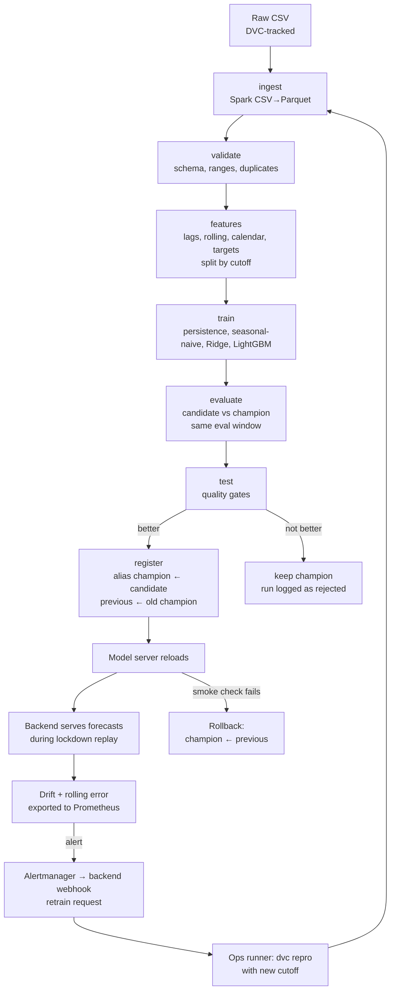

# High-Level Design

## 1. Problem and scope

I forecast hourly PM2.5 for 7 Indian cities (Delhi, Chennai, Lucknow, Hyderabad, Bengaluru, Jaipur, Kolkata), 1 hour and 24 hours ahead. The result is shown as a CPCB AQI category with health advice. I treat the COVID lockdown (25 Mar - 30 Jun 2020) as live traffic and replay it in time order. The system has to detect the resulting drift, retrain by itself, promote a new model only if it is better, and support rollback.

I picked these cities because they have a long history and less than 15% missing PM2.5 (see `docs/data_notes.md`).

## 2. Lifecycle (HLD diagram)

## 3. Design decisions

**Programming paradigm.** The pipeline stages are functional. Each transform is a function `f(DataFrame, params) -> DataFrame`, and I/O happens only at the stage entry point. The services are object-oriented: `Forecaster`, `ReplayClock`, `DriftDetector` (with the backend's `DriftReport`), `ModelRegistryClient`, `OpsRunner` and `BackendClient`. Pure transforms are easy to unit-test. The services hold state (the clock, the model version, the drift windows), so objects fit them better.

**Main data table.** I use `city_hour.csv`. It matches the "city, 1h/24h" problem directly. The station files are ingested and validated but not modelled. They are 3.6x larger and add little for a city-level forecast.

**Data engine.** Spark in local mode, with a 2g driver and 8 shuffle partitions, and Parquet after ingest. The course requires Spark. Parquet is columnar and compressed, so later stages read only the columns they need. On this small data pandas turned out about twice as fast as Spark at the ingest job (see `docs/metrics.md`). I keep Spark for the requirement and for data that would not fit in memory, but I have not measured the second reason.

**Models.** Persistence, seasonal-naive (t-24h), Ridge and LightGBM, and one served model per horizon: the better of Ridge and LightGBM. The baselines show whether the main model adds anything. I chose LightGBM because it handles NaNs and non-linear effects and is fast on CPU. It uses the median (L1) loss, because models are compared by MAE. I first used the default squared loss. On a 28-day test window the L1 version was better or equal in every comparison I ran, by about 0.7 µg/m³ at 24 h, at the price of roughly three times the training time (about 11 s per horizon). Training is deterministic (`deterministic` and `force_row_wise`). Without these two settings, two runs with the same seed and data gave predictions that differed by up to about 5 µg/m³, so a run could not be reproduced from its commit and data version.

**Missing values.** PM10 is null in about 40% of training rows, and the other inputs are 2-6% null. I keep every input column, because the input list is fixed in `docs/LLD.md`. LightGBM takes the nulls as they are. Ridge cannot, so its sklearn pipeline starts with a median imputer that also adds a missing-indicator flag for every column that has gaps, then scales the numbers and one-hot encodes city, hour, weekday and month. The imputer is fitted on the training rows only and is part of the pipeline object. The model therefore treats missing values the same way at training and at prediction time, and a missing PM10 can still carry information through its flag. Ridge is also a candidate for serving: if it beats LightGBM at a horizon, the package holds the Ridge pipeline for that horizon.

**Packaging the model.** One pyfunc called `aq-pm25` holds both horizon models, and the input carries `horizon_h`. That means one model-server process instead of two, which saves RAM, and one version number for both horizons.

**Time split.** A `cutoff` parameter (initially 2020-03-24 23:00) drives everything. Training data is everything before `cutoff − eval_window_days`, and a row only trains if its target hour is also before that point. Without this, the 24 h target of a late training row would fall inside the evaluation window. The evaluation window is the last `eval_window_days` (3) before the cutoff. Recency weights use a 90-day half-life. The same rule works for the first training and for retraining after drift. The short evaluation window compares models on the most recent regime, at the cost of a noisy estimate from only 3 days. In the first training run the window has 497 rows at 1 h and 336 rows at 24 h. I started with a 30-day half-life, and then the 24 h LightGBM sat 2.2% above the best baseline (Ridge). On a 28-day test window 30 days was the weakest setting at 24 h, so I changed it to 90 days. With 90 days LightGBM is the best model at both horizons: 4.50 at 1 h against 5.03 for Ridge, and 13.54 at 24 h against 14.25 for Ridge and 14.70 for persistence. I still do not trust small gaps on windows this short, in either direction. The same window is used for the comparison with the champion, where the short window matters most, and I report results with their row counts.

**Promotion rule.** For each horizon I register the best model, which is whichever of Ridge and LightGBM has the lower MAE on the evaluation window. That model must be within 1.02 times the best baseline for the horizon (persistence, seasonal naive or Ridge). I do not relax this limit. A new candidate is promoted only if its mean MAE over the two horizons is lower than the champion's on the same window. Comparing on the same window keeps the test fair, and the baseline condition blocks a model that is worse than a trivial one.

I decided on the per-horizon rule while the 24 h LightGBM was behind Ridge (30-day half-life), where it would have registered Ridge at 24 h. With the 90-day half-life LightGBM wins both horizons, so one model type is served and the question does not come up. The rule stays, because a retrain on lockdown data can change which model wins. The packaged model (`src/pipeline/aq_model.py`) can hold either model for each horizon. The train stage saves a LightGBM booster as `h<N>.txt` or a Ridge pipeline as `h<N>.joblib`, and `meta.json` lists which one each horizon holds (`kinds`). I used joblib for the Ridge pipeline because it ships with scikit-learn, so it adds no package. A joblib file is a pickle, so the package must only be loaded from my own registry. The Ridge path is covered by unit tests only, because on the real data LightGBM wins both horizons. "Best model" means the better of Ridge and LightGBM, as you confirmed. The rule-based baselines are the yardstick and are never served.

The `evaluate` stage loads the candidate and the champion as MLflow packages, the same way the model server will, and scores both on the same rows. The `test` stage applies the rule, and `register` creates the registry version and moves the aliases. A rejection is a normal result: the stages succeed, `reports/gate.json` says `passed: false` with the reasons, nothing is registered, and the training run is tagged `promotion=rejected`. The first model has no champion to beat, so only the baseline limit applies, and I did not relax it. A candidate that ties the champion is rejected, because a tie is not an improvement.

**Registry and rollback.** MLflow aliases `champion` and `previous` do the work. Rollback moves `champion` back to `previous`, or to a version I name. It is a metadata change, so it is instant, auditable and reversible.

**Model reload.** A watcher in the model-server container polls the `champion` alias every 30 seconds. When it moves, the watcher starts a second `mlflow models serve` process with the new version on a spare internal port, waits until it answers, points the proxy at it and stops the old one. I chose this over a plain restart because a restart drops requests for the few seconds the model takes to load. If the new model fails to start, the old one keeps serving. The backend never needs Docker access, and a promotion takes effect without manual steps.

**Model server proxy.** `mlflow models serve` has no Prometheus endpoint, so a thin proxy sits on port 5001 in front of it, counts rows per horizon, times each call and serves `/metrics` on port 8001. The cost is one extra local hop; the latencies in `docs/metrics.md` include it.

**Live traffic.** The backend's `ReplayClock` advances simulated time from 2020-03-25 at `REPLAY_SPEED_HPS` (default: 1 simulated hour per second). Forecasts use the features at the simulated "now". Actual values are revealed only when the clock passes them. This gives realistic, time-ordered traffic and lets a demo show drift within minutes.

**Drift detection.** Drift is the PSI of `pm25_lag_1` per city: the last 168 replayed hours against a same-season reference. Drift is declared when at least 4 of the 6 voting cities have a PSI above their own threshold in the same hour. The code is `src/monitoring/drift.py`, and the same module is used by the features stage (thresholds), the backend (live rule) and `scripts/replay.py` (acceptance test), so the three cannot disagree.

My first plan was to compare the live window with all the training data. That would be wrong, because PM2.5 follows the season strongly (in the EDA, Delhi is 5.5x higher in November than in August), and the replay runs from spring into summer. Normal seasonal change would look like drift. So the reference is the same hours of the calendar in earlier years, 2016 to 2019. The features stage cuts the replay window into 14 blocks of 168 hours and computes decile bins of `pm25_lag_1` for each city and block from those years. A live window whose last hour is replay hour h is compared with block `h // 168`. The result is saved in `reports/baseline_stats.json` and logged with every model as `drift_baseline.json`. Years are aligned on the replay start's month and day, so leap years do not shift the blocks. The limits are that Kolkata has only two reference years (2018-2019) and Jaipur three (2017-2019), that the station network grew over the years, and that a reference year can contain unusual events.

I measured how well a fixed PSI threshold works, and it does not. One week is only 168 hours of values that follow each other closely, and ten bins are a lot for that. In the weeks of the earlier years themselves, compared with the other years, the PSI has a median between 0.64 and 1.08 and a 90th percentile between 1.8 and 4.1. A threshold of 0.2 would fire almost every week. Lockdown weeks are higher in most cities (median 1.3 to 5.4), but they overlap with normal weeks, and in Hyderabad no lockdown week stands out (numbers in `docs/metrics.md`). So the decision rule is built from what normal weeks actually look like:

- **Per-city threshold.** For each city I compare every week (blocks 1 to 13) of every reference year with the same block of the other years, and take the 95th percentile of those PSI values as that city's threshold. The features stage writes them to `reports/drift_thresholds.json`. Kolkata has only two reference years, so this cannot be done for it, and it does not vote. The thresholds came out between 2.03 (Delhi) and 5.20 (Chennai).
- **Several cities together.** At least 4 of the 6 voting cities must exceed their own threshold in the same hour, so the weather of one or two cities cannot trigger a retrain.

**What changed in Stage 11, and why.** The rule I designed first had a second condition: the pooled 72 h MAE of the 1 h forecasts, divided by the model's 1 h MAE on its evaluation window, had to be above 1.5, and only 3 cities were needed. The idea was that PSI says the inputs changed and the MAE says it hurts. When I measured it, the rule failed both acceptance conditions. It fired for 13 hours in normal 2018, and it never fired during the lockdown. The reason is that the model's error grows with the PM2.5 level. Lockdown PM2.5 is about half of a normal spring, so the champion's error was lower during the lockdown than in any earlier year, in all 7 cities, and the ratio never went above 1.47. For this model, the lockdown changes the inputs a lot but does not make the 1 h forecast worse. The two fallbacks I had planned (2 cities instead of 3, or removing Hyderabad) only loosen the PSI side, so neither could help.

I decided with the project owner to drop the MAE condition from the trigger and to set the number of cities from normal weeks only. In 2016-2019, at most 3 cities were ever above their threshold in the same hour, so I need 4. With that rule, normal weeks give 0 drift hours and the lockdown gives 661 hours in 5 episodes, first on 2020-03-31 23:00. The weak point is that the margin is zero: one more normal week with 4 cities above threshold would be a false alarm. The thresholds were also set on the same normal weeks I test the false alarms on. The MAE ratio is still computed, exported and used by the `ForecastErrorHigh` warning, but it does not start a retrain.

The backend evaluates the rule and exports one gauge, `aq_drift_detected`. The Prometheus alert that starts a retrain watches that gauge, so the rule lives in one place. The values 95 and 4 are settings (`features.threshold_percentile` and `drift.min_cities`, which `DRIFT_MIN_CITIES` can override).

**Retraining trigger.** A Prometheus alert goes to Alertmanager, which calls `POST /ops/alerts`, which writes a retrain request file that the host ops runner picks up. The runner moves `cutoff` in `params.yaml` to the simulated time of the request, so the new model sees the replayed hours up to then, and runs `dvc repro`. The gate then decides as for any candidate. A 30-minute cooldown prevents retrain storms. No human step is needed.

**One retrain per drift episode.** The PSI reference does not change after a retrain, so during the lockdown the alert kept firing, and the cooldown alone would have caused a retrain every 30 minutes of real time. I added an episode gate. A drift alert that causes a retrain opens an episode. While it is open, further drift alerts are ignored. It closes when the drift rule has been false for `drift.episode_clear_hours` simulated hours in a row (72). I picked 72 from the replay: the first four lockdown episodes are separated by gaps of 28 to 49 hours, so they count as one, and the fifth starts after a gap of about 250 hours, so it counts as a second one. A quiet period of 72 hours is also three days, long enough that one good night does not close an episode. The trade-off is that a real second shift within 72 hours of the first is missed until the rule has been quiet. The backend evaluates the rule on every Prometheus scrape and keeps the gate state in `ops/episode.json`, so a restart does not forget an open episode.

**Memory.** Every container gets a compose `mem_limit`. Batch and the full serve stack never run together. For a retrain, the ops runner first stops the frontend and Grafana (`docker compose stop`), then checks that at least 2,500 MB are available, and only then starts `dvc repro`. When the run ends, whether it passed or failed, it starts the same containers again. The backend, model server, MLflow and the monitoring keep running, so the retrain can be watched in Prometheus and the new model can be smoke-checked as soon as it is registered. I picked the frontend and Grafana because nobody needs them while a model trains, and together they free about 160 MB, which matters with Spark's 2 GB driver on 8 GB.

The trade-off is that users cannot use the web pages for the two to three minutes of a retrain. The TLS proxy keeps running (I checked that `docker compose stop frontend` leaves it up), so instead of an empty error a browser gets a short "Back in a few minutes" page with status 503, which reloads itself every 30 s. The runner restarts exactly the containers that stopped and leaves alone a service that was already stopped by hand. Until the final audit the runner only checked memory. It ran `dvc repro` next to all 10 serve containers, which is what happened in the Stage 11 drift-to-retrain run.

`scripts/ci.sh --repro` and `scripts/bootstrap.sh` refuse to start while the serve stack is up. They are for when I run the batch myself, so the whole stack is stopped first.

**Monitoring.** Prometheus scrapes every component every 15 s and keeps 2 days. The Pushgateway is in both compose profiles and writes its values to a file, because the batch must not run next to the full serve stack: if it only existed in the serve profile, a batch would push to nothing. (Until the final audit that file was never written, because the volume was root-owned and the Pushgateway runs as `nobody`; the volume now sits on the image's own folder.) For the same reason `scripts/push_stage_metrics.py` can re-send the last measured stage records. Grafana is provisioned from JSON, so the dashboards are in git and come back after a rebuild. MLflow needed a small extra image (`docker/mlflow/Dockerfile`, the model-server image plus `prometheus-flask-exporter`) because `mlflow server --expose-prometheus` depends on that package. I did not add cAdvisor for per-container memory: it costs memory on an 8 GB machine, and the process RSS of my own services plus node-exporter's host memory answer the question I have (is anything growing?). The gap is that the `mlflow models serve` worker inside the model-server container and the MLflow server have no RSS series of their own; they show up only in host memory. Alert rules: drift (the only one that can start a retrain), forecast error (warning), backend 5xx rate above 5%, model-server errors, any target down, and a failed pipeline stage.

**Security.** The `/ops/*` endpoints need a bearer API key, which the backend compares with `hmac.compare_digest`, so the time of a wrong guess does not leak how much of it was right. Ops actions change production state, so they need authentication. Everything a client touches is encrypted: browsers reach the frontend over HTTPS through a Caddy proxy, and the backend serves HTTPS itself, so the frontend's calls (which carry the ops key) are encrypted too. Prometheus and Alertmanager talk to the backend over HTTPS as well.

I made my own small certificate authority with `scripts/make_certs.sh` and signed one server certificate with it, instead of one bare self-signed certificate. Both are self-made and no browser trusts them by default, but with a CA every service checks the backend's certificate against `ca.crt` and none of them turns verification off. A browser shows a warning on the first visit; importing `ca.crt` once removes it. The trade-off is that warning, which a public certificate would avoid, but that needs a domain name and an outside service, and the project runs with no cloud. Inside the compose network, traffic to the model server, MLflow and the exporters stays plain HTTP: it never leaves the machine and carries no secret.

I put the frontend behind Caddy rather than using Streamlit's own TLS option because Streamlit cannot redirect plain HTTP. With its option on, `http://localhost:8501` gives an empty error page, which is exactly the kind of confusing error a non-technical user should not see. Caddy redirects port 80 and the old 8501 address to `https://`. Secrets (the ops key, the Grafana password) live only in `.env`. Alertmanager cannot read environment variables in its config, so its entrypoint writes the key to a file in `/tmp` inside the container when it starts, and there is no second copy of the key on disk. Every container runs as a non-root user (the Caddy image defaults to root, so compose sets the user), and no container gets the Docker socket.

**Reproducibility.** Every MLflow run is tagged with `git_commit`, `dvc_data_md5` and `cutoff`. Every forecast response returns `model_version`, `mlflow_run_id` and `git_commit`. Any prediction can be traced back to its exact code, data and run.

**Frontend.** I wrote the frontend in Streamlit with two pages. The Forecast page has a city dropdown (no free text, so a user cannot type an unsupported city), one colour card per horizon in the CPCB colour of the category, and the advice text. If the backend is down it shows a plain sentence instead of a stack trace. The Pipeline console shows the DVC DAG as a Graphviz drawing coloured by each stage's last status, the stage durations and rows per second, the run history with error messages, the model versions, and links to MLflow, Grafana and Prometheus. Drift and the ops buttons (replay, retrain, rollback) are hidden until the operator types the API key. The console does not read the key from the environment: if it did, anyone who could open the page could press the buttons. The key is checked by the first `/ops/drift` call, and a wrong key shows no buttons. The frontend never imports backend code. Its only door is `src/frontend/client.py`, which reads `BACKEND_URL`. What I did not do: the page does not refresh by itself, because auto-refresh on a phone costs battery and a Refresh button is enough for a forecast that changes once per simulated hour.

**Loose coupling.** The frontend uses only `BACKEND_URL` and the REST contract in `docs/LLD.md`. The backend uses only `MODEL_SERVER_URL` and `MLFLOW_TRACKING_URI`. Each service can be rebuilt, moved or replaced on its own.

## 4. AQI mapping

I apply the CPCB PM2.5 breakpoints (µg/m³) to the forecast value. The official AQI uses 24h averages, so the UI labels the category as *indicative*.

| Category | PM2.5 | Colour | Health advice (CPCB) |
|----------|-------|--------|----------------------|
| Good | 0-30 | #00B050 | Minimal impact. |
| Satisfactory | 31-60 | #92D050 | Minor breathing discomfort to sensitive people. |
| Moderate | 61-90 | #FFFF00 | Breathing discomfort to people with lung disease such as asthma, and discomfort to people with heart disease, children and older adults. |
| Poor | 91-120 | #FF9900 | Breathing discomfort to most people on prolonged exposure. |
| Very Poor | 121-250 | #FF0000 | Respiratory illness on prolonged exposure. |
| Severe | > 250 | #C00000 | Affects healthy people and seriously impacts those with existing diseases. |

## 5. Deployment

The limits are in `docker-compose.yml`. The last column is what the containers really used, measured with `docker stats` on 2026-10-27 at idle (more in `docs/metrics.md`).

| Profile | Services | Sum of mem_limit | Measured at idle |
|---------|----------|-----------------:|-----------------:|
| serve | tls-proxy 64m, frontend 384m, backend 512m, model-server 768m, mlflow 768m, prometheus 384m, pushgateway 64m, alertmanager 64m, grafana 256m, node-exporter 64m | 3.3 GB | 1.23 GiB |
| batch | pipeline 2.5g (Spark driver 2g); a host `dvc repro` peaked at 1.0 GB resident in its largest process | 2.5 GB | |
| during retrain | batch + serve without frontend and Grafana (stopped by the ops runner) | 5.2 GB | |

## 6. Failure handling

If validation fails (a wrong schema or an impossible value), the `validate` stage fails and the run is recorded as `failed` with the reason. The champion stays unchanged.

If a candidate is worse than the champion or the baselines, the `test` stage marks it rejected. Nothing is registered as champion, and the run is visible in the console.

If a new champion fails the smoke check (the model server does not answer with the new version and a sane value within 180 s), the ops runner moves `champion` back to `previous`, marks the request `rolled_back` and logs it.

If the model server is down, the backend returns 503 with a clear message and the UI shows a friendly "forecast temporarily unavailable" notice.

If the backend is down, the UI shows a friendly error and the Prometheus `up == 0` alert fires.
