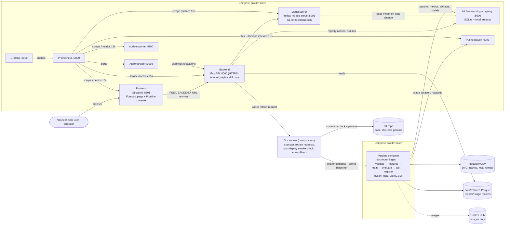

# Architecture

Everything runs locally on one ARM64 VM under Docker Compose. I split the stack into two compose profiles. **serve** is always on. **batch** holds the Spark pipeline and training, and I start it only when needed.

## The blocks

**Frontend (Streamlit).** It has two pages. The Forecast page is for ordinary users: a city dropdown, the 1h and 24h PM2.5 forecast, an AQI colour card and health advice. The Pipeline console is for the operator: DAG status, run history with failures and error messages, throughput, drift, model versions and the ops buttons. I kept the frontend ignorant of everything except `BACKEND_URL`. That way I can replace it or move it without touching the rest.

**Backend (FastAPI).** This is the single REST API the UI talks to. It builds the feature row for a city at the simulated "now", calls the model server, and turns PM2.5 into an AQI category with advice. It also runs the lockdown replay clock, computes drift and rolling error, handles the ops actions behind the API key, and receives Alertmanager webhooks. I put all the logic here so the UI stays thin, and so `docs/LLD.md` is the one contract between the UI and the system.

**Model server (MLflow).** It serves the registered pyfunc model `aq-pm25` at the alias `champion` through `/invocations`. A small watcher inside the container starts the new version next to the old one when the alias moves (promotion or rollback), then switches over, so no request fails. A thin proxy in front of `mlflow models serve` provides the Prometheus metrics. The course asks for MLflow to expose the model as an API, and this also keeps the model runtime separate from the API logic.

**MLflow tracking and registry.** It stores runs (parameters, metrics, artifacts, git commit, data hash) and model versions with the aliases `champion` and `previous`. Tracking, promotion and rollback all go through this one registry.

**Pipeline (batch).** This is the 7-stage DVC DAG. Spark handles ingest, validate and features. LightGBM, Ridge and the naive baselines handle train, followed by the evaluation gate and registration. DVC gives me the CI DAG and the data versioning, and Spark is the engine the course requires for data engineering.

**Ops runner (host).** It watches `ops/requests/` for retrain requests. When one arrives it pauses the frontend and Grafana, runs the batch pipeline, commits `dvc.lock`, restarts the paused services, smoke-tests the new champion and rolls back if that fails. Pausing is how I stop batch and the full serve stack from running together on 8 GB. I run it on the host because starting containers from inside a container needs the Docker socket, and I don't want to hand that to any container.

**Prometheus, Pushgateway and node-exporter.** Prometheus scrapes every component every 15 seconds. The pipeline pushes its stage metrics to the Pushgateway, because batch jobs are too short-lived to be scraped. node-exporter reports host RAM and CPU. Together they cover monitoring of all components.

**Alertmanager.** It routes drift and error alerts to the backend webhook. The backend logs them, and drift alerts create a retrain request. This closes the loop from monitoring to alert to retraining.

**Grafana.** Its dashboards are provisioned from JSON and refresh every 15 seconds.

**DVC local remote, Git and Docker Hub.** DVC holds data and model versions, git holds code and the pipeline lock, and Docker Hub holds the published multi-arch images. Docker Hub stores images and nothing else.
