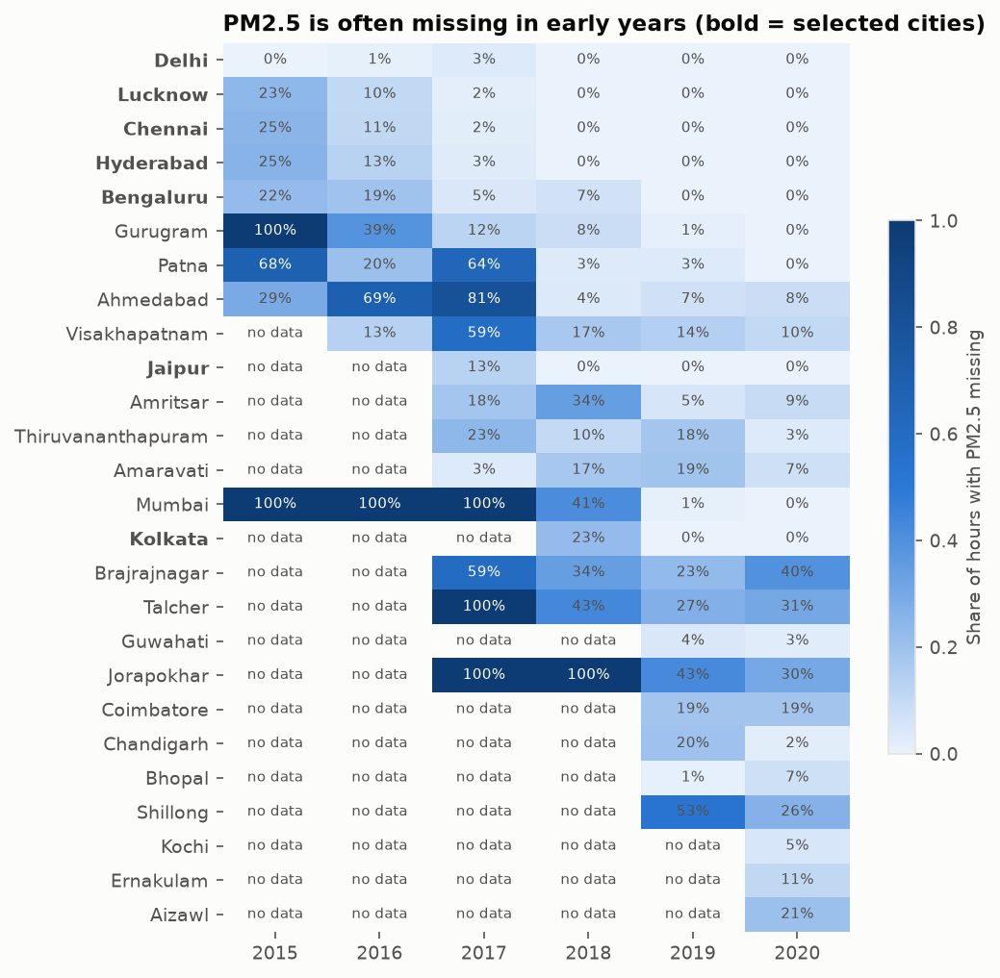
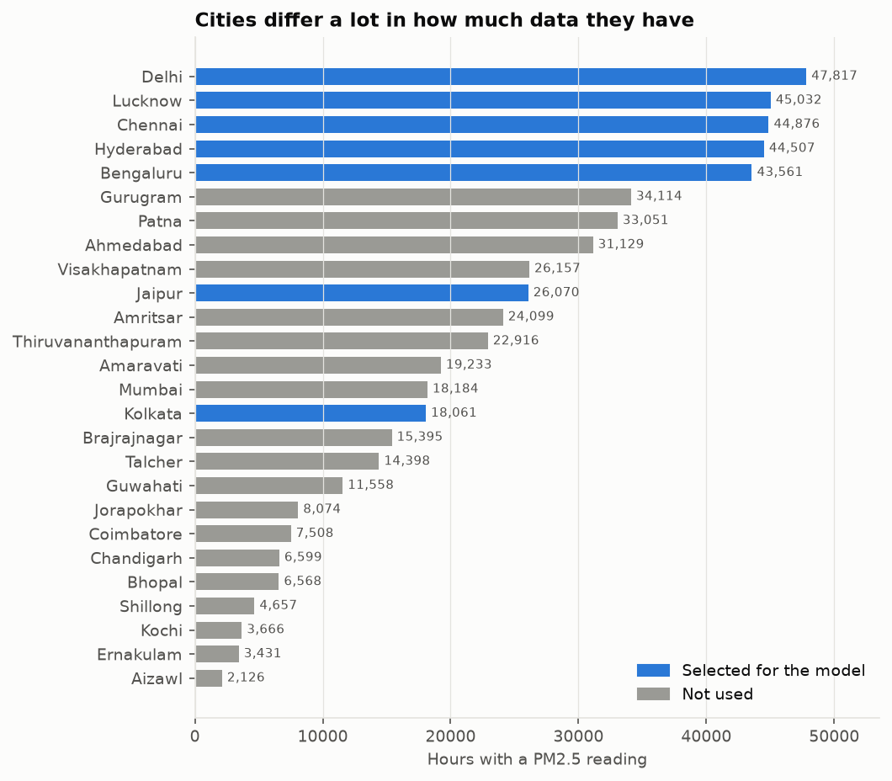
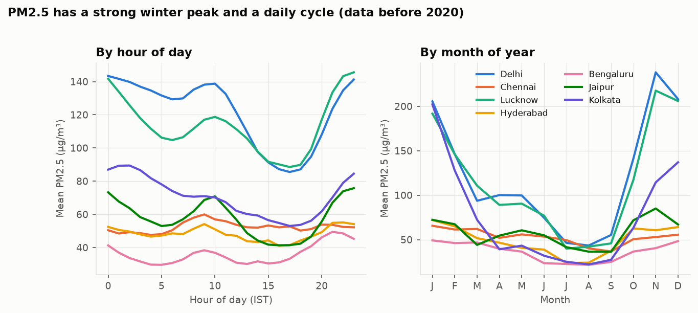
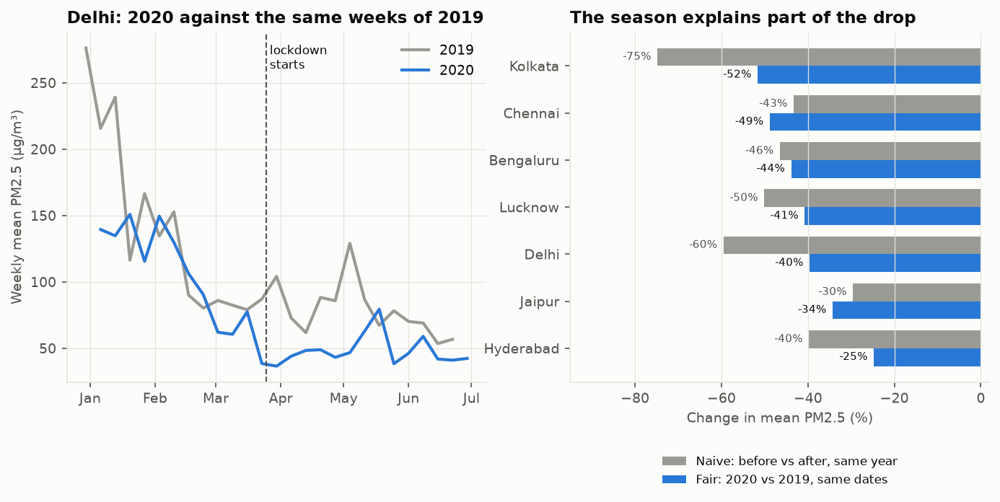
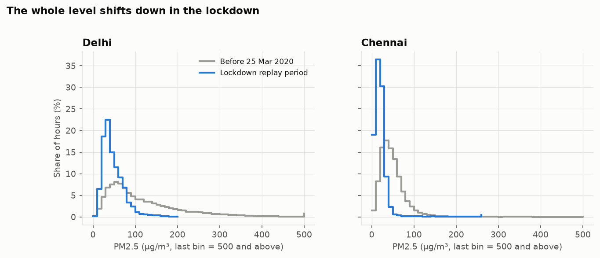

# Exploratory Data Analysis and Data Biases

Before modelling anything I wanted to know two things: what the data looks like, and where it could mislead the model. This page is what I found.

The Spark part takes about 10 seconds:

```bash
python -m src.pipeline.eda      # Spark counts -> reports/eda/*.csv (small, kept in git)
python scripts/plot_eda.py      # CSV files -> docs/img/eda_*.png
```

PM2.5 is the fine-dust measure I forecast, in µg/m³. Lower is better. Unless I say otherwise, the numbers come from `city_hour.csv` (hourly, 26 cities). The 7 selected cities are Delhi, Chennai, Lucknow, Hyderabad, Bengaluru, Jaipur and Kolkata.

## 1. Data is missing, mostly in early years



In 2015-2017 many cities miss 10-100% of their PM2.5 readings. By 2019 the selected cities miss almost nothing. Mumbai has no PM2.5 at all until 2018 (100% missing in 2015-2017), which is why I left it out. Some small cities, such as Jorapokhar and Talcher, are still 27-43% missing in 2019-2020.



Delhi has 47,817 hours of PM2.5. Aizawl has 2,126. A model will be much better for some cities than for others, and I should expect that.

## 2. Pollution follows strong daily and yearly patterns



| City | Mean PM2.5 in Aug | Mean PM2.5 in Nov | Ratio |
|------|------------------:|------------------:|------:|
| Delhi | 43 | 238 | 5.5x |
| Lucknow | 42 | 218 | 5.2x |
| Kolkata | 22 | 114 | 5.2x |
| Bengaluru | 22 | 40 | 1.8x |
| Chennai | 40 | 53 | 1.3x |

North and east cities have a very strong winter peak (Oct-Feb). South cities are flat and low. Within a day, PM2.5 is highest around 22:00-01:00 and lowest around 16:00-17:00. Averaged over the 7 cities it is 86 at 23:00 and 57 at 16:00.

This is why I give the model hour, weekday and month as inputs. It is also why I expect the "same hour yesterday" baseline (seasonal-naive) to be hard to beat.

## 3. The 2020 lockdown lowers the level, but less than it first looks




I compared the mean PM2.5 (µg/m³) in the replay period (25 Mar - 30 Jun) in two ways.

| City | Before lockdown 2020 (1 Jan - 24 Mar) | Lockdown 2020 | Naive change | Same dates 2019 | Fair change (2020 vs 2019) |
|------|------:|------:|------:|------:|------:|
| Delhi | 118 | 48 | -60% | 79 | -40% |
| Lucknow | 106 | 53 | -50% | 89 | -41% |
| Kolkata | 79 | 20 | -75% | 41 | -52% |
| Chennai | 38 | 22 | -43% | 43 | -49% |
| Bengaluru | 41 | 22 | -46% | 39 | -44% |
| Jaipur | 48 | 34 | -30% | 51 | -34% |
| Hyderabad | 45 | 27 | -40% | 36 | -25% |

My first comparison was the naive one: the weeks before and after 25 March in 2020. It was wrong for my purpose, because it mixes the lockdown with the normal drop from winter to summer. So I compared the same dates in 2019 instead. That "fair" change ranges from 25% to 52% lower, against 30-75% for the naive one. In four cities (Delhi, Lucknow, Kolkata, Hyderabad) the naive number overstates the lockdown effect by 9-23 points. In Chennai, Bengaluru and Jaipur it is about the same or smaller.

The effect is still large and real in all 7 cities, so it makes a good drift story, as long as I say that part of the shift is seasonal. The lockdown period also has almost no very high hours (see bias 5), so the data after 25 March differs in shape and not only in level.

## 4. Data biases and what I do about them

**1. City choice.** I model 7 cities with good, recent data. They have 18k-48k hours of PM2.5, with none missing in 2019-2020. Gurugram, Patna and Ahmedabad have more hours than Kolkata but I left them out because 15-35% of their values are missing overall. The results will not carry over to small or north-east cities such as Aizawl, Shillong or Kochi. The app only offers the 7 cities, the list is fixed in `params.yaml`, and the user manual will say so.

**2. Missing data is not random.** It is concentrated in 2015-2017 and in certain cities (see the heatmap). Early years carry less information, and a typical year is mostly 2018-2019. I do not fill gaps with made-up values. I drop rows without a target and use a short forward-fill (up to 3 h) only for lag inputs. LightGBM handles the remaining gaps.

**3. A city value averages whichever stations reported, and the network grew.** Delhi had 8-10 stations in 2015-16 and 36-37 from 2018. Kolkata went from 2 stations in 2018 to 7 in 2019. A jump in a city's level can come from adding stations and not from the air getting worse, so old and new years are not fully comparable. I treat 2018 onwards as the most reliable, and I report per-city error in MLflow so weak cities stay visible.

**4. Stations are in cities, mostly in busy places.** CPCB monitors are urban. Forecasts describe city-station air, not rural air or every neighbourhood. The UI says "readings from official city monitoring stations".

**5. Extreme hours are few, and rare outside the north.** Before the lockdown, hours with PM2.5 of 250 or more were 9.6% in Delhi, 7.7% in Lucknow and 3.0% in Kolkata, and under 1% everywhere else. In the lockdown period they were 0% in most cities. The model sees few examples of "Severe" air, so it will under-predict peaks, and a model retrained on lockdown data will see almost none. I will report error for high values separately in the test report and state the limit in the user manual.

**6. Season and lockdown are mixed up.** Section 3 shows it: in Delhi, Lucknow, Kolkata and Hyderabad the naive drop is 9-23 percentage points bigger than the fair one. A drift alarm that compares the replay with all seasons mixed would therefore be partly seasonal, not only COVID. Month is an input feature. For drift, I compare the live window with the same hours of the calendar in earlier years, not with all seasons mixed (see `docs/HLD.md`), so the normal change of season does not count as drift. A lockdown that moves levels beyond a normal spring still does.

**7. Sensors have limits and glitches.** Values stop at fixed ceilings: PM10 hits exactly 1000 in 57 hourly rows, and PM2.5 tops out just under 1000. No selected city reaches the PM2.5 ceiling. Hyderabad repeats the exact previous value in 3.0% of hours (1,343 hours), while the other selected cities do so in 0.1-0.7%. There are no zeros. Flat runs in Hyderabad suggest a stuck sensor, and they teach the model that "tomorrow = today". I kept those hours but flagged them, I check Hyderabad's error per city, and validation fails on values above the ceiling.

**8. The data ends on 1 July 2020 and the replay is my only "new" data.** I cannot test on any other future year, and one regime change is my only drift example. In the viva I will be clear that the lockdown replay is a simulation of live traffic.

**9. I do not use the official AQI.** `AQI` and `AQI_Bucket` are blank in about 18% of hourly rows. Using them as a label would drop many rows and mix in other pollutants. The target is PM2.5, and I calculate the category myself from the CPCB PM2.5 bands.

## 5. Data quality (selected cities)

These numbers come from Stage 5 and from this page.

| City | PM2.5 hours | Same value as the hour before | Zeros | At sensor ceiling |
|------|------------:|------------------------------:|------:|------------------:|
| Delhi | 47,817 | 83 (0.17%) | 0 | 0 |
| Lucknow | 45,032 | 79 (0.18%) | 0 | 0 |
| Chennai | 44,876 | 61 (0.14%) | 0 | 0 |
| Hyderabad | 44,507 | 1,343 (3.02%) | 0 | 0 |
| Bengaluru | 43,561 | 167 (0.38%) | 0 | 0 |
| Jaipur | 26,070 | 182 (0.70%) | 0 | 0 |
| Kolkata | 18,061 | 66 (0.37%) | 0 | 0 |

Stage 5 (`reports/validation.json`) also found no duplicate rows, no negative values, no missing ids or timestamps, and all timestamps on the hour.

## 6. Where the numbers are

| File | Content |
|------|---------|
| `reports/eda/missing_by_city_year.csv` | Hours and PM2.5 count per city and year |
| `reports/eda/coverage_by_city.csv` | First and last PM2.5 date, counts per city |
| `reports/eda/seasonality.csv` | Mean PM2.5 by hour and by month (before 2020) |
| `reports/eda/weekly_series.csv` | Weekly mean PM2.5, 2019 to mid-2020 |
| `reports/eda/period_means.csv` | Means for the 2019 and 2020 windows (section 3 table) |
| `reports/eda/histogram.csv` | Counts per 10-unit PM2.5 bin, before vs during lockdown |
| `reports/eda/quality_flags.csv` | Repeats, zeros, ceiling hits (section 5 table) |
| `reports/eda/stations_per_year.csv` | Stations with PM2.5 data per city and year |
