# User Manual

This app tells you how much fine dust (PM2.5) to expect in your city in 1 hour and in 24 hours. It shows a colour and a short piece of health advice. You don't need to know anything about the technology behind it to use it.

There are two pages:

- **Forecast** is for everyone. You pick a city and read the forecast.
- **Pipeline console** is for the person who runs the system (the "operator"). Most users never need it.

> **This is a demo.** The app replays real measurements from March to June 2020 as if they were happening now. The dates you see are from 2020. I chose that period because it includes the COVID lockdown, when the air suddenly got much cleaner, and the system has to notice that and adapt.

---

## 1. Starting the app

### If someone has already started it for you

Open your web browser and go to **https://localhost** (or the address you were given, for example `https://192.168.64.7`). Skip to section 2.

If you type `http://localhost` or `localhost:8501`, that works too. The app sends you to the secure address by itself.

### If you start it yourself

You need a computer with Docker, uv and Java 17 installed, and a copy of the project folder. You do the set-up once, in the project folder:

```
scripts/bootstrap.sh
```

It prepares everything and trains the first model, which takes a few minutes. It also writes the file `.env` with `OPS_API_KEY`, the operator password for the console. Keep that file to yourself.

After that, starting the app takes two commands:

```
docker compose --profile serve up -d
uv run --frozen python -m src.ops.runner
```

The first starts the app. The second starts the **ops runner**, the helper that trains new models. Leave it running in its own terminal window. Without it, the app still works and still notices drift, but it never trains a new model: the retrain requests just wait in a queue. When you start the runner later, it works through the queued requests.

Wait about half a minute, then open **https://localhost**. To stop everything, press Ctrl+C in the runner's window and run:

```
docker compose --profile serve down
```

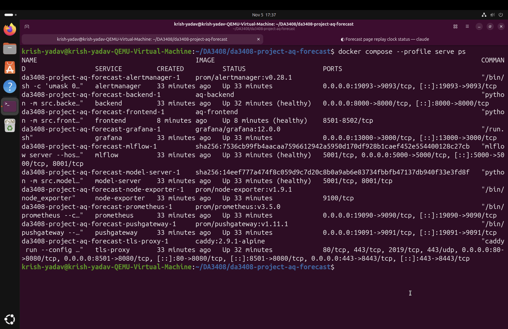

---

## 2. The browser warning ("Your connection is not private")

The first time you open the app, your browser will probably show a warning page. It says something like **"Your connection is not private"** (Chrome) or **"Warning: Potential Security Risk Ahead"** (Firefox).

**What it means.** The connection *is* encrypted. The browser is only saying that it doesn't recognise who issued the security certificate. Public websites buy their certificates from a company the browser already trusts. This app runs only on your own computer with no internet service, so I made its certificate myself, and your browser has never heard of me.

**What to do (quick way, fine for a demo):**

- **Chrome / Edge:** click **Advanced**, then **Proceed to localhost (unsafe)**.
- **Firefox:** click **Advanced...**, then **Accept the Risk and Continue**.

The browser remembers this choice, so you only do it once.

**How to recognise the warning:** Chrome and Edge show a page titled "Your connection is not private". Firefox shows "Warning: Potential Security Risk Ahead". Both have an **Advanced** button near the bottom. If you see either page at `https://localhost`, follow the steps above.

**What to do (permanent way, no more warnings):** import the file `certs/ca.crt` from the project folder into your browser as a trusted "authority".

- **Chrome:** Settings > Privacy and security > Security > Manage certificates > Authorities > Import, choose `ca.crt`, and tick "Trust this certificate for identifying websites".
- **Firefox:** Settings > Privacy & Security > Certificates > View Certificates > Authorities > Import, choose `ca.crt`, and tick "Trust this CA to identify websites".

Only do this for a `ca.crt` file you made yourself or got from someone you trust. It tells your browser to trust any site that certificate vouches for.

**How to check the import worked:**

1. Close every browser window and open the browser again.
2. Go to `https://localhost`.
3. The Forecast page opens straight away, with no warning page in between.

---

## 3. The Forecast page

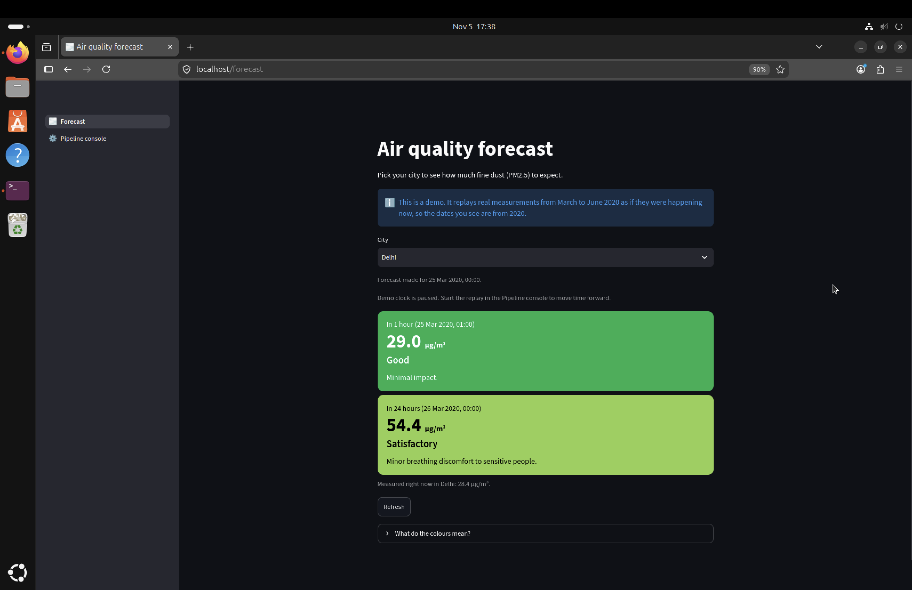

1. **Choose your city** from the **City** list. There are seven: Delhi, Chennai, Lucknow, Hyderabad, Bengaluru, Jaipur and Kolkata. You can't type a city name. The list holds only the cities the system has a model for, so you can't pick one it doesn't know.
2. **Read the two cards.** The top card is **"In 1 hour"** and the second is **"In 24 hours"**. Each card shows:
   - the time the forecast is for,
   - the expected amount of PM2.5, in µg/m³ (micrograms per cubic metre of air; lower is better),
   - the category name, such as **Good** or **Poor**,
   - one sentence of health advice for that category.
3. Under the cards, **"Measured right now"** is the latest real measurement for your city (the average of the official CPCB monitoring stations there), so you can compare it with the forecast.
4. Press **Refresh** to get a new forecast. The replay clock keeps moving, so the forecast changes over time.

The line "Forecast made for ..." tells you the (replayed) time the forecast starts from.

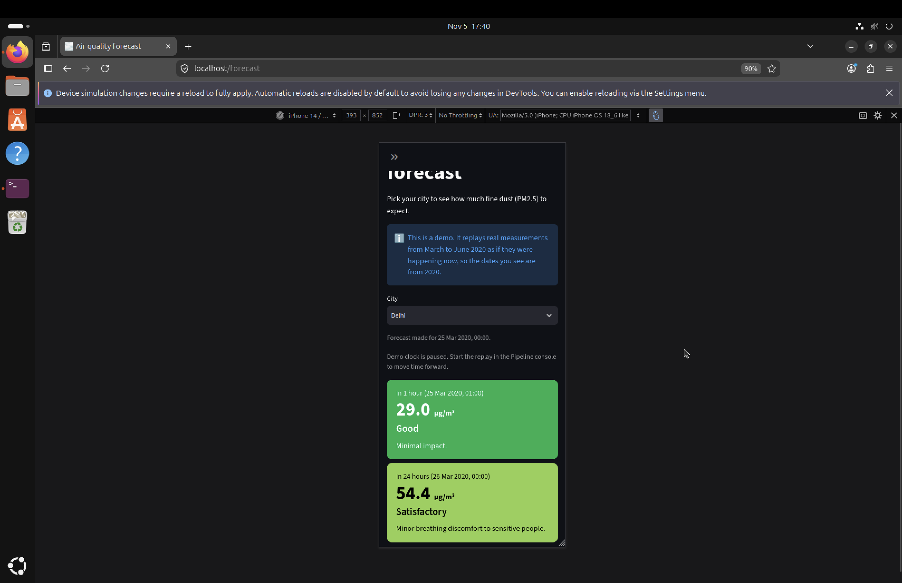

### What the colours mean

The colours and advice follow the official Indian air-quality scale (CPCB). Open **"What do the colours mean?"** at the bottom of the page to see the same table in the app.

| Colour | Category | PM2.5 (µg/m³) | What it means for you |
|--------|----------|---------------|------------------------|
| Dark green | **Good** | 0 to 30 | Minimal impact. |
| Light green | **Satisfactory** | 31 to 60 | Minor breathing discomfort to sensitive people. |
| Yellow | **Moderate** | 61 to 90 | Breathing discomfort to people with lung disease such as asthma, and discomfort to people with heart disease, children and older adults. |
| Orange | **Poor** | 91 to 120 | Breathing discomfort to most people on prolonged exposure. |
| Red | **Very Poor** | 121 to 250 | Respiratory illness on prolonged exposure. |
| Dark red | **Severe** | 251 and above | Affects healthy people and seriously impacts those with existing diseases. |

A practical way to read it: green means go about your day; yellow means people with asthma, heart problems, children and older people should take it easy outdoors; orange and red mean most people should limit long or hard outdoor activity; dark red means everyone should avoid it.

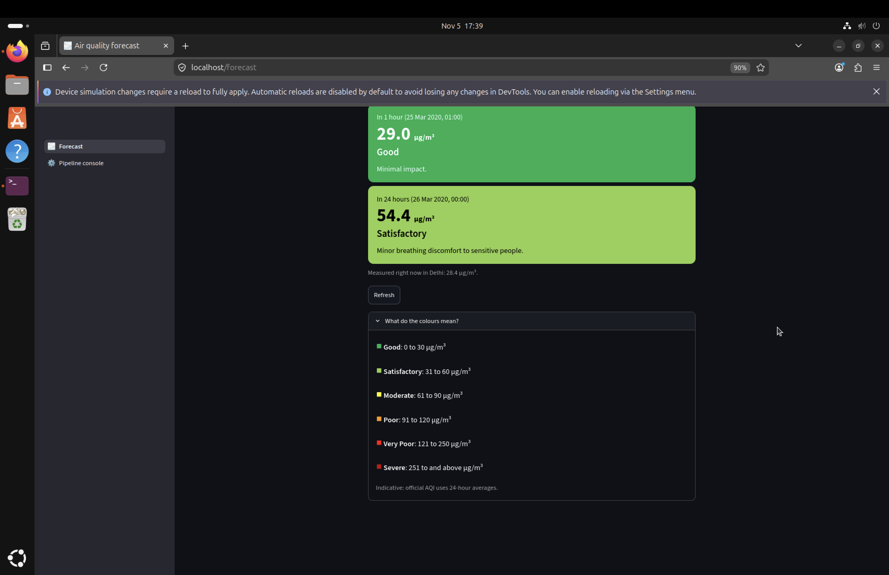

**Two things to keep in mind:**

- This is a forecast, not a measurement. In my tests the 1-hour forecast was off by about 3.5 µg/m³ on average, and the 24-hour forecast by about 9 µg/m³. So a value close to the edge of a category could fall on either side. The 24-hour forecast is the less certain one. It is least accurate on the most polluted hours, because there are few of them in the data it learned from, so a very high level may be forecast too low.
- The official AQI is based on a 24-hour average. These cards show a single hour, so the colour is a guide, not the official AQI. The app says this under the colour table.

### If something goes wrong

The page never shows technical error messages. Instead you may see:

| Message | What it means | What to do |
|---------|---------------|------------|
| "Sorry, the forecast service is not reachable right now. Nothing is wrong with your device..." | The part of the system that makes forecasts is not running or not reachable. | Wait a few minutes and press Refresh. If it stays, tell the operator. |
| "The forecast model is taking a break, so there is no forecast at the moment..." | The model is restarting, for example while a new one is being switched in. | Wait a minute and press Refresh. |
| "Back in a few minutes" | A new model is being trained and the page is switched off for two to three minutes, or the page is restarting. | Nothing. The page reloads by itself every 30 seconds. |
| The browser warning page | See section 2. | |

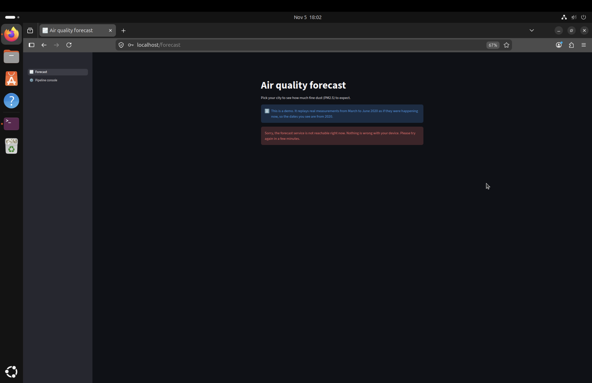

---

## 4. The Pipeline console (for the operator)

Open it from the link **Pipeline console** in the left sidebar, or go to **https://localhost/console**.

Everything at the top of the page can be seen without a password. The buttons that change things need the operator key.

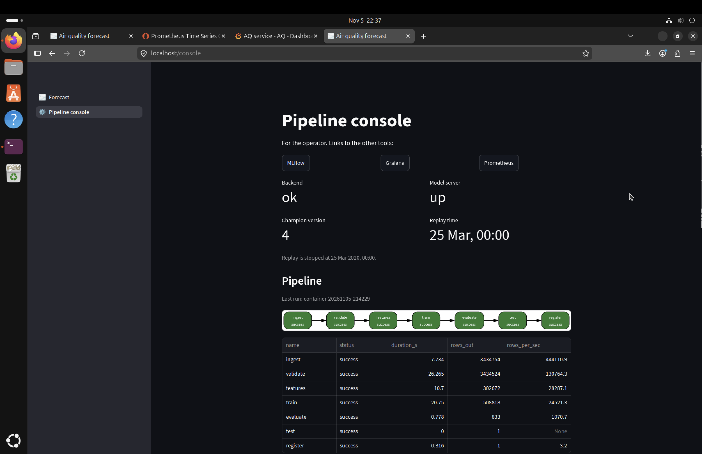

### What you see without the key

- **Links** to the three tools behind the scenes: **MLflow** (the list of trained models and their results), **Grafana** (live charts) and **Prometheus** (raw monitoring data and alerts).
- **Four status boxes:** whether the backend is OK, whether the model server is up, which model version is in use (the "champion"), and the replay time. Underneath it says whether the replay is running.
- **The pipeline diagram.** These are the seven steps that turn raw data into a model: ingest → validate → features → train → evaluate → test → register. Each box is coloured by how that step went the last time it ran (green for success, red for failure, grey for a step that was skipped or has not run yet).
- **The step table:** how long each step took, how many rows it produced, and its speed in rows per second.
- **Runs:** how many recent runs succeeded and how many failed, then a table of the last 20 runs. If a run failed, its error message is in the table.
- **Model versions:** every model in the registry, with its labels. `champion` is the one in use, and `previous` is the one a rollback would go back to.

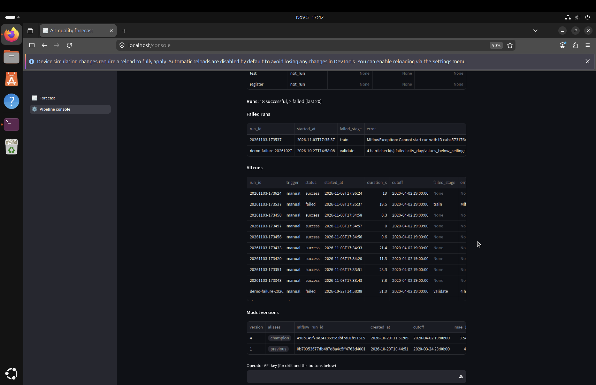

### Entering the operator key

Type the key (`OPS_API_KEY` from the `.env` file) into the **Operator API key** box. The app checks it with the backend straight away:

- If it's wrong, you see **"The API key is wrong."** and no buttons.
- If it's right, the **Drift** and **Operations** sections appear.

The key is not saved anywhere. If you reload the page, you type it again.

### Drift

"Drift" means today's air looks very different from the same weeks in earlier years. The model learned from earlier years, so it may need retraining. The section shows:

- **Drift detected:** YES or no.
- **Cities above threshold:** for example `5 / 4` means 5 cities look unusual, and 4 are needed to call it drift.
- **Error ratio (72 h):** how the model's recent error compares with its error in testing. It's for information only and does not trigger anything.
- A table with each city's score and its own limit.

When drift is detected, the system starts a retrain by itself, as long as the ops runner is running (section 1). You don't need to press anything. If the runner is not running, the request waits in a queue until you start it.

While a retrain runs, the web pages (Forecast and this console) and Grafana are switched off for two to three minutes to free memory for the training. During that time the browser shows a short page saying **"Back in a few minutes"**, which reloads by itself. The rest of the system keeps running.

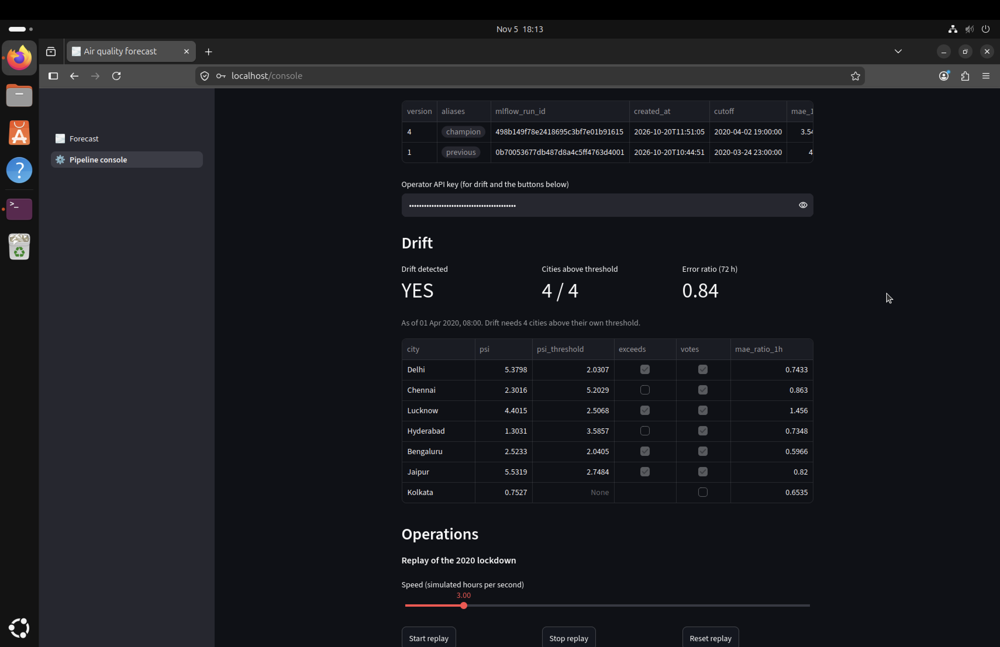

### Operations (the buttons)

| Control | What it does | When to use it |
|---------|--------------|----------------|
| **Speed** slider and **Start replay** | Plays March to June 2020 forward, at the chosen number of simulated hours per second. At 1, a day passes in 24 seconds. | To demo the lockdown and watch drift appear. |
| **Stop replay** | Pauses the replay where it is. | |
| **Reset replay** | Goes back to 25 March 2020 and stops. | To start the demo again. |
| **Reason** and **Retrain now** | Asks for a new model to be trained on the data up to the current replay time. The new model replaces the current one **only if it is measurably better**. Otherwise the current one stays. | If you want to retrain without waiting for drift. Only one retrain can run at a time. |
| **Version to restore** and **Roll back** | Switches back to an older model. Leave the box empty to go back to the one used before, or type a version number. The forecast page uses it within about 30 seconds. | If a new model behaves badly. Pressing it again undoes the rollback. |

After each button you see a green message with the result, or a red one if it was refused. For example, a retrain is refused while another is still running, and a rollback is refused for a version that doesn't exist.

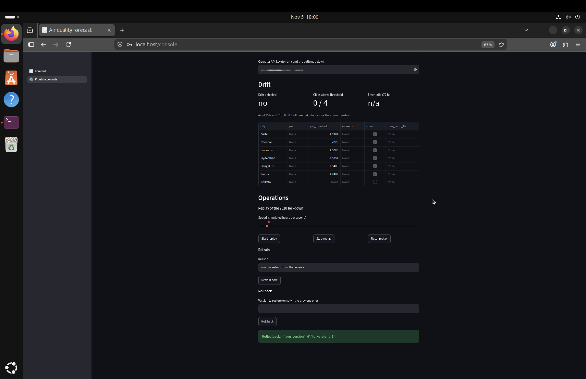

A retrain needs about 2.5 GB of free memory. To get it, the ops runner switches off the web pages and Grafana while it trains, and switches them back on afterwards, also when the training fails. The retrain runs in the background. Afterwards you can see it in the runs table. While it runs you can follow it in Prometheus, which stays on.

### Grafana dashboards

The **Grafana** link opens the live charts without a login (view only). The home dashboard, "AQ service", shows forecasts, response times, error rates, drift scores per city and memory use. A second dashboard, "AQ pipeline", shows the seven steps' durations and speeds. Both update every 15 seconds.

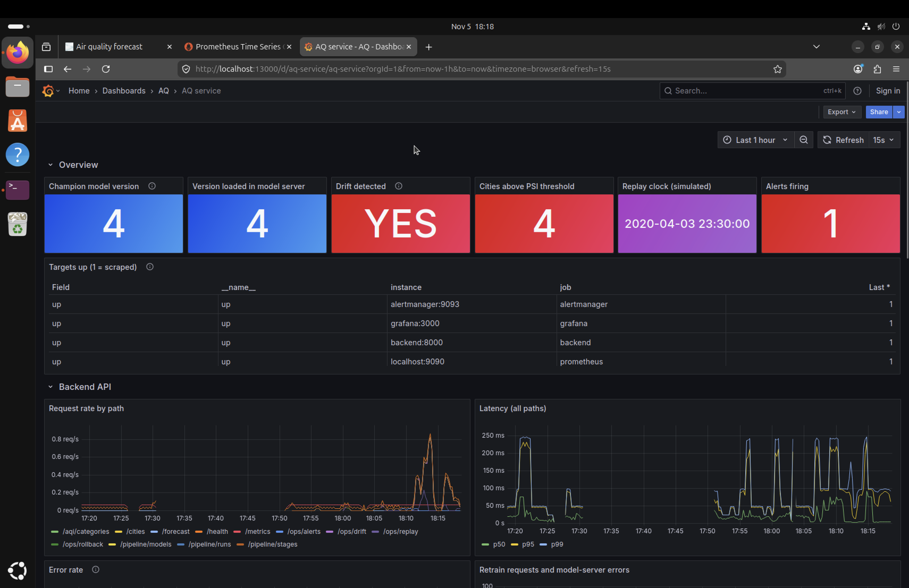

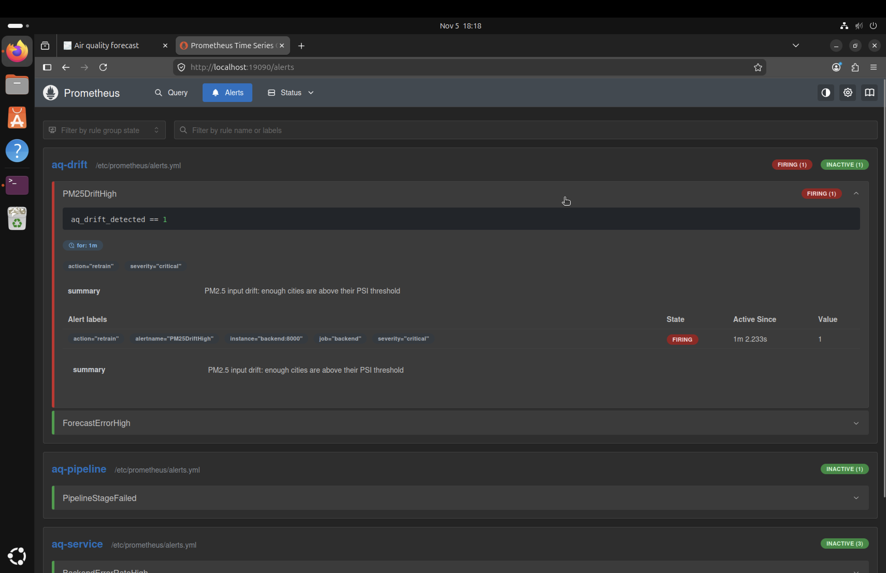

---

## 5. Questions

**The dates say 2020. Is the app broken?**
No. It is a demo that replays 2020 as if it were now (see the note at the top of the Forecast page).

**Why is my city not in the list?**
The system only has a model for seven cities with enough good historical data.

**The colour changed between two refreshes. Why?**
The replay clock moves forward, so each refresh can be a later hour. The model may also have been replaced by a better one after a retrain.

**The forecast never changes. Is it stuck?**
Look under the date on the Forecast page. If it says "Demo clock is paused", nobody has started the replay, so time does not move. Start it in the Pipeline console. When it is moving, the page says "Replay running".

**Can I use it on my phone?**
The page layout stacks into one column on a narrow screen. Your phone must be on the same network, and you open the computer's address (for example `https://192.168.64.7`). You'll see the certificate warning there too. I have not yet tested it on a real phone.
